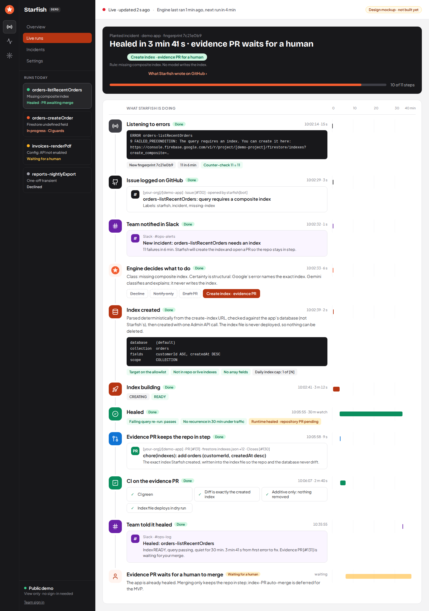

# Starfish

**An AI ops engineer for teams that don't have one.**

Starfish watches a production Firebase/GCP project, judges which incidents are actually
urgent, drafts a fix, adversarially reviews its own work, and opens a verified pull request
— then stops and waits for a human.

Named for the animal that regrows what it loses.

## Try the live demo

### **[ocean-starfish.web.app](https://ocean-starfish.web.app)**

- **No account needed to look.** Opening the link puts you in a read-only view of a live
  deployment that watches a demo project.
- **Judges: sign in for the full records.** The email and password are in our presentation
  slides (deliberately not here). Signed in, you see what the view-only demo leaves out: error
  detail, stack traces, Gemini's reasoning and the patches.
- **A three-step guide opens on your first visit.** The **?** button in the header reopens it.

What happens to an incident:

1. **Ingest:** reads the watched project's new error logs on a schedule and folds repeats of one
   error into one incident (one that comes back after a fix is reopened as a regression).
2. **Triage:** Gemini judges whether it needs action and how far to go: noise, log it, or attempt a fix.
3. **Fix:** Gemini drafts a minimal patch, or declines when there is no confident one-step fix.
4. **Verify:** deterministic, not a model: in the demo, the watched project's own CI checks judge the patch.
5. **Review:** a second Gemini pass attacks the verified patch before anything is opened.
6. **Pull request:** opened with its evidence; then Starfish stops and a person decides. It merges
   only where an admin turned that on, for the cases they listed, with every check green.

Where to look: **Overview** (is the engine alive, what is waiting on a person), **Incidents** (each
error and what the agent decided; open one for its evidence), **Runs** (every agent run, step by
step), **Settings** (the switches and rules an admin controls). Every number is a record the
deployment wrote; one marked **Synthetic** is an illustration, not a run that happened. How far
each stage has got on real incidents is in [Status](#status).

---

## Why

Sentry's Seer needs Sentry and a team around it. Google's Gemini Cloud Assist is built for
enterprises that already employ SREs. Both assume an engineering organisation exists.

Nobody builds for the two-person company running real production for real users — which is
the long tail of most software that actually matters to the people using it.

That's the gap Starfish is for.

## Design goal: configured, never forked

Starfish is meant to be **generic** — one engine, pointed at different projects by
configuration alone. The test is deliberately falsifiable:

> **Nobody should have to edit `src/` to run Starfish against their own project.**

Everything deployment-specific belongs in `src/config.ts` and nowhere else. If adopting
Starfish somewhere new requires touching engine code, that's a bug in the design, not a
missing feature.

Where it currently holds, and where it doesn't:

| | Status |
|---|---|
| Service attribution | ✅ config patterns — no hardcoded service list |
| Project, environment, collection, database, lookback | ✅ config (engine `src/config.ts`, UI `web/src/lib/config.ts`); these are the defaults, and the engine's need a redeploy to change |
| Watched project, environment label, log resource types, service patterns, noise list, and the pipeline switches (dry run, review required, model calls per cycle) | ⚠️ an admin edits them on the Settings page; the engine validates the saved document and applies it over the defaults, falling back to the last good one (`src/runtimeSettings.ts`); with neither, ingest refuses to run rather than read the defaults' target (#198). `firestore.rules` let only admins write it, each save in one batch with an immutable audit entry (before and after) and a separate operator copy (the settings without who saved them, which operators and the public demo's guests see read-only); the engine's last-good copy and any secret-shaped key are closed to clients. The editor and the engine run the same validator (`src/settingsSchema.ts`). Rules check each list's shape and size but not each entry (they have no loops); the engine checks entries on read. Tested on the emulator, and the editor's own save is the one the rules suite runs. `pnpm ingest` reads it on each run (`src/ingest/run.ts`), and `scripts/deploy-gcp.sh` defines the scheduled job that runs it (deployed once, to the demo project, 2026-10-05, #6); secrets (Secret Manager and its endpoint). The pipeline switches (dry run, review required, automation, model calls) are stored and applied the same way, and the agent job (`DEPLOY_AGENT=1`, deployed to the demo project and run there since 2026-10-08) reads them at the start of each pass; the verify command, its timeout and the excluded paths stay environment-only on purpose (an editable command would be code execution on the engine host, and the excluded paths guard the judge). Single-target: one watched project per deployment |
| Vertex project, model and region | ⚠️ they default to `STARFISH_VERTEX_PROJECT_ID` (else `GOOGLE_CLOUD_PROJECT`, so Gemini can run in a different project from the store), `STARFISH_MODEL` and `GOOGLE_CLOUD_LOCATION`, and an admin can override all three on the Settings page (validated by the same schema and by `firestore.rules`); the agent job builds its model client from each pass's snapshot (`createAskJson` in `vertex.ts`, one client per project and region), so an override reaches the call. Another Vertex project needs the agent's account granted `roles/aiplatform.user` there, which the deploy script does only for its own `VERTEX_PROJECT_ID`. That job runs on the demo project; `pnpm spike` stays on the environment's values |
| Deployment-specific values in tracked code | ✅ `scripts/check-no-project-ids.mjs` (run by `pnpm run verify`'s lint step) fails on a GCP project id, Firebase/Cloud Run domain or Hack2Skill name in `src/`, `web/src/` or `scripts/` outside an allowlist of example placeholders. A pattern check, not a proof: it can't recognise a project id that has none of the shapes it looks for |
| Firebase project the UI connects to | ✅ read at startup from Hosting's `/__/firebase/init.json`, so one build serves any project (`VITE_FIREBASE_*` is the local-dev fallback). `scripts/deploy-web.sh` deploys it to its own Hosting site; it ran once, on the demo project (2026-10-05), from a terminal (#12); the Actions workflow that runs it has never run |
| UI environment label | ✅ follows the runtime settings once signed in (the build-time `VITE_STARFISH_ENV` is the fallback when none is set or the read fails) |
| UI collections and region | ⚠️ still `VITE_*`, baked in at build time |
| Collection names in `firestore.rules` | ⚠️ hardcoded `incidents` / `starfish_users`; rules can't read config, so a renamed collection means editing the rules file |
| Dry run, review required, model-call budget, automation kill switch | ⚠️ environment defaults (`STARFISH_DRY_RUN` on by default, `STARFISH_REVIEW_REQUIRED`, `STARFISH_MODEL_CALL_BUDGET`, `STARFISH_AUTOMATION_ENABLED` on by default) that an admin can override on the Settings page (first row); the loop reads them; the agent job that runs it (`DEPLOY_AGENT=1`) is deployed to the demo project and runs there. The kill switch is read fresh before every stage (`src/agent/automationSwitch.ts`) and fails closed: if the settings cannot be resolved and nothing good is known, it reads as off |
| GitHub target (repository, base branch, API and remote URL, commit identity) and token | ⚠️ environment only (`STARFISH_GITHUB_REPO` empty by default, so nothing can be opened; `STARFISH_GITHUB_BASE_BRANCH`, `_API_URL`, `_REMOTE_URL`, `_COMMIT_NAME`, `_COMMIT_EMAIL`); the token is read on its own from `STARFISH_GITHUB_TOKEN` and is not part of the config object. One repository per deployment |
| Where a missing index may be created, and whether | ⚠️ environment only (`STARFISH_INDEX_ALLOWED_TARGETS`, empty by default: nothing allowed and the index path not wired; `STARFISH_INDEX_AUTO_APPLY`, off by default; `STARFISH_INDEX_DAILY_CAP`, 3 per target per UTC day; `STARFISH_INDEX_PROBES`, the failing queries, empty by default so nothing can be created; `STARFISH_INDEX_FILE`, `STARFISH_INDEX_WAIT_MINUTES`, `STARFISH_INDEX_OBSERVE_MINUTES`; a malformed value stops startup). Run by `pnpm agent` when a target is allowed; tested against fakes and the emulator, **never run against Google** |
| Verify isolation, cycles per agent pass | ⚠️ environment only (`STARFISH_VERIFY_ISOLATION`, default `none`: the agent will not start; `in-process` is not a sandbox; `github-actions` (the demo's choice) pushes the patch to a `starfish/<cycle>` branch and lets the target's own CI judge it, with `STARFISH_VERIFY_CHECKS` naming the checks (counted only from `STARFISH_VERIFY_CHECK_APP`, default `github-actions`); `cloud-run-job` runs the command in a separate job whose service account holds no roles, with `STARFISH_VERIFY_JOB`, `_BUCKET`, `_JOB_REGION` (both written, never run, #74); `STARFISH_MAX_CYCLES_PER_PASS`, default 3; `STARFISH_MAX_CYCLES_PER_DAY`, default 30 per UTC day; reconsidering a declined incident: `STARFISH_RECONSIDER_COOLDOWN_MINUTES` 30, `_MAX_PER_DAY` 3, `_BURST_OCCURRENCES` 20) |
| Agent cycle collection, lease length, cycle deadline, attempts | ⚠️ environment only (`STARFISH_CYCLE_COLLECTION`, `STARFISH_LEASE_SECONDS`, `STARFISH_CYCLE_DEADLINE_MINUTES`, `STARFISH_MAX_CYCLE_ATTEMPTS`); the rules name `starfish_cycles` too |
| What guests may see, and where its trimmed copies live (#18) | ⚠️ environment only (`STARFISH_PUBLIC_ENVIRONMENTS`, default `demo`, empty turns the copies off; `STARFISH_PUBLIC_INCIDENT_COLLECTION`, `_CYCLE_COLLECTION`, `_EVENT_COLLECTION`, and the UI's `VITE_STARFISH_PUBLIC_*`). The rules name the `starfish_public_*` collections and serve guests the `demo` label only, so another label needs a rules edit too. What a copy holds is an allowlist in code (`src/publicView.ts`), not a setting |
| Ingest lag, longest window, run-record collection | ⚠️ environment only (`STARFISH_INGEST_LAG_MINUTES`, `STARFISH_INGEST_MAX_WINDOW_HOURS`, `STARFISH_RUN_COLLECTION`); the rules name `starfish_runs` too |
| New incidents one function may open per ingest window (#303) | ⚠️ environment only (`STARFISH_MAX_NEW_INCIDENTS_PER_FUNCTION`, default 25). Past it, a function's errors that match no stored incident are folded into one high-cardinality overflow incident per function and UTC day, counted in the run record; unit- and emulator-tested, not yet run on a real flood |
| Services Starfish never ingests (its own) | ✅ config (`STARFISH_EXCLUDED_SERVICES`, default `starfish`), applied at query time and at parse time; environment-only on purpose, because it guards against a feedback loop and is not an operational preference. `scripts/deploy-gcp.sh` sets it on every job it deploys, unless `EXTRA_ENV_VARS` gives its own: `starfish`, the ingest job's name and the admin API's service name, whether or not that run deploys the admin API, and on the agent job also its own name and, with `cloud-run-job`, the verify job's (#32, #177) |
| Log source resource types | ⚠️ config, but attribution reads only `function_name` / `service_name`, so only Cloud Functions and Cloud Run work |
| Framework-noise suppression list | ✅ config, callable GET-probe noise by default |
| Class rules: how far Starfish may go per kind of incident (the rules engine) | ✅ config (`STARFISH_CLASS_RULES`, empty by default), and an admin's list on the Settings page replaces it; an operator's correction lives on the incident, its history under `incidents/{id}/corrections`, a name `firestore.rules` fixes like the collections above |
| Cloud Monitoring failure signal (#19) | ⚠️ environment only (`STARFISH_MONITORING_ENABLED`, default off; `STARFISH_MONITORING_RESOURCE_TYPES` picks among the two built-in metrics, `cloud_run_revision` and `cloud_function`; `STARFISH_MONITORING_MAX_SERIES`, default 500); another metric needs code. `scripts/deploy-gcp.sh STARFISH_MONITORING_ENABLED=true` sets it and grants `roles/monitoring.viewer` on the watched project. Never run against real Monitoring |
| Phone escalation (#37): switch, recording, webhook origin, Twilio credentials, the on-call rota and policy | ⚠️ the deployment's switch and wiring are environment only (`STARFISH_PHONE_ESCALATION`, default off; `STARFISH_ONCALL_AUDIO_URL`; `STARFISH_TWILIO_WEBHOOK_URL`; `STARFISH_TWILIO_API_URL`; the collections `STARFISH_ONCALL_COLLECTION`, `STARFISH_ONCALL_PEOPLE_COLLECTION`, `STARFISH_ESCALATION_COLLECTION`); Twilio's account SID, auth token and from-number are secrets read on their own (`loadTwilioCredentials`), stored and mounted by `scripts/deploy-gcp.sh`. The people, their numbers and the policy (the admin's switch, the wait, quiet hours and time zone, the daily cap per person, what counts as critical) are edited by an admin in Settings -> On-call, in admin-only collections the rules name by their default names. The call order (primary, primary again after 2 minutes, secondary, support lead) is fixed in code. Built, tested against a fake Twilio and the emulator, never run against real Twilio |
| Deployment: project, region, schedule, the watched and Gemini projects, the environment label | ✅ environment variables of `scripts/deploy-gcp.sh`; no file is edited. Run once, on the demo project (2026-10-05): the ingest job, its schedule, the database and rules deployed and a scheduled run succeeded (#6). The admin API (`DEPLOY_ADMIN_API=1`) was deployed once, on 2026-10-07; the agent job (`DEPLOY_AGENT=1`) has never been deployed. `.github/workflows/deploy.yml` runs the same script, by hand or (once a person turns it on) on a merge, with Workload Identity Federation and repository variables, no stored key; written and pinned by a test, **never run** (#75) |
| Incident store | ❌ assumes Firestore |
| Where the fixer's source is looked for when no stack frame names a repository file (#259) | ⚠️ environment only (`STARFISH_FUNCTIONS_SOURCE_ROOTS`, default the whole checkout); the search's bounds (2,000 code files, 20M characters) are fixed in code |
| Verify-gate command, timeout and excluded paths | ⚠️ environment only (`STARFISH_VERIFY_COMMAND`, `STARFISH_VERIFY_TIMEOUT_SECONDS`, `STARFISH_PATCH_EXCLUDED_PATHS`); `src/agent/verifyGate.ts` reads them; in the isolated deployment only the verify job runs it (written, never run) |

The ❌ rows are tracked work, not accepted limitations.

## Known blind spot: logs are not the only signal

Ingestion reads Cloud Logging only. The production pipeline this ingest is adapted from found that
Firebase **gen2** (Cloud Run) functions can fail without emitting an ERROR-severity log at
all: a log-only reader then reports "no errors" while Cloud Monitoring still counts the
failed invocations. The fix there was a second, Monitoring-derived source feeding the same
store.

Starfish now has that second source (#19), **built, tested against fakes only, off by default, and
never run against real Cloud Monitoring** (`STARFISH_MONITORING_ENABLED=false`). Turned on, each ingest
window also reads the watched project's failure metrics (`src/ingest/monitoring.ts`): 5xx responses
from `run.googleapis.com/request_count` (Cloud Run, gen2 functions) and non-ok executions from
`cloudfunctions.googleapis.com/function/execution_count` (gen1), one bounded count per function, each
with its metric, resource type, project and observation window. A function that also logged an
ERROR in that window has its log incidents annotated (`monitoringCount`); one that did not gets a
**Monitoring-only incident** (`signalSource: monitoring`), fingerprinted in a namespace of its own so it
never merges with a log-derived one. A Monitoring read that fails is recorded as unavailable
(`last_run.monitoring.unavailableWindows`), never as zero failures, and that window is not re-read: a
retry would need the window's log incidents to correlate against, and the store's replay guard is per window
and fingerprint for occurrences and readings together, so re-reading one signal alone would either count the
logs twice or drop the annotation.
Triage never declines a Monitoring-only incident because its log counter-check is zero, and never lets
one become `act` without cause evidence on the incident (a cause or a stack trace, which a count of
failures does not carry): it goes to a human (`notify`) instead. Enabling it needs
`roles/monitoring.viewer` on the watched project, which `scripts/deploy-gcp.sh` grants only when run with
`STARFISH_MONITORING_ENABLED=true` (dry-run tested; never run). The Incidents page and the evidence page
badge a Monitoring-only incident and show `monitoringCount` and the latest window's readings (provenance and
count). With it off, which is every deployment today, a clean
ingest run still means *no logged errors*, not *no errors*.

## How it works

```
Cloud Logging  ──▶  incident store  ──▶  Gemini triage      "is this actually urgent?"
                    (fingerprint,          │
                     occurrence count,     ▼
                     counter-check)      Gemini fix-draft   "what's the minimal patch?"
                                           │
                                           ▼
                                         verify gate        lint · typecheck · test · build
                                           │                (deterministic — NOT the model)
                                           ▼
                                         Gemini review      adversarial: try to break it
                                           │
                                           ▼
                                         pull request       ← stops here unless Gemini named an admin's
                                                              merge case: then auto-merge on green checks
                                                              (demo target only, off by default; built, never run)
```

The verify gate is deliberately *not* an LLM. The model proposes; the test suite disposes.

## The trust ladder

Writing a fix is the easy part. Knowing when it's allowed to act is the hard part.

Starfish runs no deploy of its own, but **a merge is a release**: the target's own CI/CD ships what
is merged. **How far it goes with an incident is Gemini's decision**, inside limits an admin sets
(decided in
[`docs/design/auto-merge-policy.md`](docs/design/auto-merge-policy.md)):

| Level | What Starfish does | Who decides |
|-------|--------------------|-------------|
| noise | records it, files nothing | Gemini's triage: *decline* |
| **log** | a GitHub issue and an alert; a person fixes it | Gemini's triage: *notify* (also where a fix is declined or fails a check) |
| **log + fix** | the issue and a verified, reviewed pull request; a person merges | Gemini's triage: *act* |
| **log + fix + merge** | Starfish merges the fix itself, then watches for the error coming back and reverts | Gemini's triage: *act* **and** one of the admin's **merge cases** |

Merge cases are an admin's list on the Settings page (`id: description`, also `STARFISH_MERGE_CASES`),
empty by default: nothing merges until an admin lists a kind of incident that is high-value and
low-risk to fix. Gemini reads the descriptions and must name one; a case it names that is not listed
is dropped. `missing-index` is the index path's own case: no model, since Google's error names the
index; listed, its evidence pull request merges once the checks are green. **The model decides
whether to merge; it never decides what is safe to merge.** Every merge also needs, checked again
right before it: the switches (`STARFISH_AUTO_MERGE_TARGETS` lists the target, the demo; an admin
turned `autoMerge` on; dry run and the merge freeze off; the case still listed), the **safety floor**
(one production file; tests only as new files, so a fix can't turn CI green by weakening a test; nothing
on the hard-exclude list's words: auth and access control, security rules, money, secrets, schema,
dependencies and imports, CI config, shared packages, judged on the whole function around each change;
and, since a list of words misses a check that names none of them, rules on the code itself: at most 40
changed lines, no deciding line or call removed, no network, process, dynamic-code, destructive or
file-system call and no `://` added, and no call the file did not already make but a few pure ones such as
`String` or `Array.isArray`; a scanner, not a proof),
**every required check green on the exact head**, at most `STARFISH_MAX_MERGES_PER_DAY` (3) a day, and
an evidence comment posted first. Fast-revert is built with it: the same incident seen again within N
minutes of a code merge opens and merges a revert. **Built for the demo target behind default-off
switches, tested against fakes and the emulator, never run against real GitHub.** Rungs 1 to 3 are
still not built, which is why every other target stays PR-only.

People can always hold Starfish back, never push it further (`src/triageRules.ts`, #267):

- **Rules engine.** An admin's class rules (Settings → Class rules, also `STARFISH_CLASS_RULES`) match an
  incident's error type, error code, service or function and set the most Starfish may do with it: *noise*
  declines it without asking the model, *log* turns Gemini's *act* into an issue for a person, *fix* opens
  the pull request but never merges it.
- **Feedback engine.** An operator corrects one incident from its page: "this should have gone no further
  than X". The correction caps that incident the same way. It stops a merge still waiting for its checks.
  A declined incident corrected to anything above noise goes back to triage. Every correction is kept as
  history, and `pnpm feedback-corpus` turns the noise and log corrections into replay cases, so
  `pnpm replay` can measure whether Gemini's own triage now agrees.

The lowest cap wins, so an operator can't lift an admin's rule. Widening what merges stays the admin's
merge cases and switches: Starfish never widens a class by itself, from a replay score or anything else.
**Built, tested against fakes and the emulator; not yet run on a real incident.**
Autonomy is earned in stages, not switched on:

| Rung | Guardrail | Status |
|------|-----------|--------|
| 0 | Full verify gate on every patch | designed |
| 0 | Adversarial self-review before a human sees it | designed |
| 0 | Human-gated stop at PR — runs no deploy; merges nothing (and so releases nothing) unless rung 4 is switched on for that target | designed |
| 1 | Integration-suite re-run required for merge eligibility | planned |
| 2 | End-to-end coverage of the affected user flow | planned |
| 3 | Blast-radius limits + rollback/canary story | planned |
| 4 | Scoped auto-merge: Gemini names an admin's merge case, inside the safety floor, on green checks, with fast-revert | built for the demo target only, off by default, never run against real GitHub; every other target waits on 1–3 |

Each rung is a prerequisite for the next. Rung 4 is not a switch we get to flip on our own.

## Where the UI is heading

**Mostly designed, not built.** The operator UI today has sign-in, an **Overview** landing page, the
incidents table, an editable settings page, a **Runs** page and an incident evidence page. The mockups below show where it is going and how the
demo runs.

- **Live runs:** a first version is built: the **Runs** page lists the agent's cycles and draws
  each one's steps (triage, fix, verify, review, pull request) from the events the engine records,
  live. A step with no event reads "not reached", and a run with no worker holding it is not shown
  as in progress. **The agent job that fills it runs on the demo project, hourly** (deployed 2026-10-07 in dry run; live since 2026-10-10, with nothing opened or merged yet; its first
  runs, on 2026-10-08, stopped at the fix stage, #259); on a deployment without it the page is empty unless the synthetic demo history (`pnpm seed-demo`, badged "Synthetic") was written; it is exercised against the emulator with seeded data. The header shows the path, the
  triage rule, progress (steps recorded) and the engine's last run. The GitHub-issue and Slack steps appear when a run
  recorded them. A missing-index run shows its own steps (the index, then its evidence pull request) and where the
  index stands at runtime (watching, healed, recurred). The phone escalation's calls (#37) appear as one step when a
  run recorded them. Not built: the deploy and recovery steps (the loop has no code for them), and the four MVP cases
  observed end to end (#33 stays open).
- **Incident evidence:** a first version is built: `/incidents/:id`, linked from the incidents table
  and from the Runs page, shows what was detected and, from the agent's run record, the triage,
  fix, verify, review and pull request results, with "not reached" for any stage not recorded. It
  draws the incident's last 24 hours of occurrences as bars, and shows the independent raw-log recount triage
  judged on (beside the store's count, with the exact filter when it is short enough to keep whole; a missing
  recount says missing, never zero), the model that decided, the alternatives the fixer rejected and each
  attack the reviewer tried. It does not store the patch text (only its SHA-256): when a pull request was opened,
  the fix stage links to its diff on GitHub instead.
- **Overview:** a first version is built and is the page the app opens on: how many runs wait on a
  human, runs in progress, open incidents, regressions, errors per hour (from the incidents' hourly
  buckets), key figures (pull requests opened and failed runs, each as "n of N finished runs"; median run length; untriaged open incidents; errors this hour against the hours before it), what the agent did by path (each row opens the Runs list filtered to runs that ended that way), the latest runs, the latest activity (the newest run events across all runs, each opening its run) and the engine's status. Every figure is a
  count or median of stored records, not an accuracy score (no run has been scored; see `scoreboard/FORMAT.md`). "Healed on its own" counts
  only missing-index runs the engine recorded as healed after their quiet window (`src/indexheal/observe.ts`) and opens the Runs list filtered
  to them; a merged pull request is never counted as healed (the auto-merge step records a merge on the cycle, `summary.merge`, but the
  Overview does not count it), and nothing has been healed or merged on a real project. On a real deployment the run
  counts are zero until a job runs the agent loop.
- **Slack messages and GitHub issue/PR bodies:** what Starfish posts elsewhere.
- **Pre-recorded phone call:** to the on-call person when Slack goes unanswered. Built (#37, below), off by default,
  never run against real Twilio.
- **Settings:** connections, the engine's rules and on-call.

The Incidents page opens with a line saying whether the engine is running (from the engine's last-run record: failed, stopped past a configurable threshold, falling behind the newest logs, read capped, or never recorded), so a quiet list can't pass for good news; the scheduled ingest job writes that record (`scripts/deploy-gcp.sh` deploys and schedules it; deployed once, on the demo project, 2026-10-05, #6). Under each incident's error is the agent's run for its current recurrence: the run's state (in the Runs page's words), triage's reason as recorded, and a link that opens that run on the Runs page; the expanded row has the decision, its rule and the reason in full. It says "No agent run yet" only when every run of the environment was read, and nothing when it could not tell.

The public demo needs no sign-in: a visitor is signed in anonymously and sees the Overview, the incidents and their evidence, the Runs page and a view-only Settings page, all for the `demo` environment only, with no triage buttons (#12). A guest never reads the stored incident, cycle or event documents: `firestore.rules` serve a guest only **trimmed copies** the engine writes for the `demo` environment (#18, see [Redaction limits](#redaction-limits) below), so the guest pages show no error detail, stack trace or model reasoning. That needs Anonymous sign-in enabled in the Firebase project and only `demo`-labelled data. App Check is built as an option, off unless the UI is built with a reCAPTCHA site key (`VITE_STARFISH_APPCHECK_SITE_KEY`), and enforcing it on Firestore is a console step left to a person; an optional uptime check and alert on the site come with `UPTIME_CHECK=1 scripts/deploy-web.sh`. Both are tested only with stubs and dry runs, never on a real project ([deploy.md](docs/deploy.md#app-check-and-the-uptime-check-12)). Until the agent has carried real incidents through every stage, the demo can also carry a **synthetic** evidence history: `pnpm seed-demo` (see [Synthetic demo history](#synthetic-demo-history)), every record of which the UI badges "Synthetic". A private deployment leaves Anonymous sign-in disabled and still requires an operator account.



Every screen, and what each one is for: [`docs/design/mockups.md`](docs/design/mockups.md). To click
through them, open [`docs/design/html/index.html`](docs/design/html/index.html) in a browser after cloning
(GitHub shows HTML files as source, not as pages).

## Google Cloud stack

What each service does here, and how far it has got. "Written" means the code or script exists and
is tested; "deployed" means it has run in a real project: the ingest half and the web UI, once, on the demo project
(2026-10-05, #6), the admin API once, on 2026-10-07, and the agent job, on 2026-10-07; on 2026-10-10 the Deploy engine workflow redeployed all three, and the agent has run since with dry run off and auto-merge on for the demo target. No incident has gone through it yet: nothing has been opened or merged.

| Service | Used for | Status |
|---|---|---|
| Vertex AI (Gemini) | triage, fix drafting, adversarial review | built as stages with a stubbed model; the spike runs real Gemini on fixtures |
| Cloud Logging | the errors Starfish watches | built (ingest) |
| Firestore (its own `starfish` database) | incidents, settings, cycles, run records | built; rules and store tested on the emulator |
| Firebase Auth | operator sign-in, guest view | built |
| Cloud Run (a job) | runs one ingest per tick, as its own least-privilege service account | `Dockerfile` and deploy script written; deployed once, on the demo project (2026-10-05) |
| Cloud Run (a service): the admin API | "Run ingest now", "Run agent now" (#276) and Retire for an admin, from the UI (`DEPLOY_ADMIN_API=1`) | in the deploy script; deployed once, to the demo project (2026-10-07), and "Run ingest now" ran from the UI; Retire, the Twilio routes and "Run agent now" (built later, never run against real Cloud Run) not tried |
| Cloud Run: agent job and verify job, Cloud Storage bucket | the agent runs triage → fix → review; the target's tests run only in a separate job whose service account holds no roles, fed through the bucket (`DEPLOY_AGENT=1`) | in the deploy script (`docs/deploy.md`); never deployed |
| Cloud Scheduler | starts that job on a cron (`SCHEDULE`, hourly by default) | in the deploy script; deployed once, on the demo project (2026-10-05); the agent's tick never deployed |
| Secret Manager | the GitHub token the pull-request step uses; the Slack webhooks and Twilio's credentials (#37) the same way, in secrets of their own | secret, access grant and mount are in the deploy script, and `loadGithubToken()` reads it; the opener is built and tested against a local git remote and a fake API, **not against real GitHub**; its only caller is the agent job (a dry run, never run) |
| Firebase Hosting | the operator UI, on its own site (not the project's default one) | `scripts/deploy-web.sh` and the Hosting config written; deployed once, on the demo project (2026-10-05), from a terminal; the Actions workflow never run |
| Cloud Build, Artifact Registry | build the image (`gcloud run jobs deploy --source`; one build per job) | in the deploy script; used once, by the demo project's deploy (2026-10-05) |
| Cloud Monitoring | a second signal beside logs (see the blind spot above) | built and tested against fakes; off by default (`STARFISH_MONITORING_ENABLED`); never run against real Cloud Monitoring; the deploy script grants its role only with `STARFISH_MONITORING_ENABLED=true` |

## Status

Early, but not from scratch. The ingestion half is adapted from an incident pipeline the
authors run in production for their own product: Cloud Logging query and false-positive suppression, error
classification, fingerprint dedup, rolling occurrence buckets, redaction. Most of its
apparent over-engineering is scar tissue from real incidents, and the tests in
`src/ingest/ingest.test.ts` pin the behaviours that were learned the expensive way:

- classification trusts what the source asserted before guessing from message text
- an unattributable function resolves to `"platform"` — never to whichever service is
  listed first, which is a real bug that mislabelled alerts for weeks
- audit logs and callable-framework GET probes are dropped at both query and parse time
- a resolved incident that fires again is re-opened as `recurred`, a regression that keeps
  the resolution that didn't hold; an ignored one is never re-opened (`store.test.ts`)
- an open incident is found by its fingerprint, so a busy function's burst can't fork one
  incident into several (`store.test.ts`)
- every write is one Firestore transaction through a per-fingerprint key document, so
  concurrent ingest runs converge on one incident, lose no hourly count, and an operator
  resolving an incident mid-run either lands after the occurrence or turns it into exactly
  one recurrence (`store.emulator.test.ts`, on the emulator)
- an ingest run reads one bounded window of logs at a time, (start, end], ending a few minutes
  behind the clock so late-arriving entries are in it. The window is saved as *pending* before
  anything is read, the checkpoint advances only after every upsert of it has committed, and a
  retry replays the same window, and two runs that overlap are given the same one (claimed in a transaction); the incident key remembers the windows it applied, so a window
  replayed after a half-failed run counts once, even under concurrency (`run.emulator.test.ts`,
  `store.emulator.test.ts`). A window is read oldest first, a page at a time, each page reduced to parsed
  entries before the next is read; a read that hits the 5,000-entry cap, or 64 MB of entries
  (`STARFISH_INGEST_READ_BUDGET_MB`, #296: a Cloud Logging entry can be 256 KB, and a burst of large ones ran the
  512Mi job out of memory on every replay), writes nothing and narrows the pending window to the part it read in
  full, and the rest is read by the windows after it (#127). A window with more than that in its first
  millisecond, or one an earlier attempt already began writing (narrowing it would give it a new id and count
  those writes again, #199), is processed as read and flagged capped on the run record. A pending window three
  attempts in a row did not finish (failed, timed out or killed) is split in half before the next attempt, when
  nothing was written under it (#296). A narrowing does not use up one of a run's eight windows; the run budget
  bounds those (#297). The run record says how far the checkpoint is behind the newest logs it could read, and
  `pnpm status` and the UI's engine line call the ingest "behind" past twice the schedule's interval
  (`STARFISH_INGEST_BEHIND_MINUTES` / `VITE_STARFISH_BEHIND_MINUTES` to set it), so a flood that outpaces the runs
  no longer reads as ok (#297). Built and tested against a fake Logging and the emulator; no flood has gone through
  the deployed job. `pnpm ingest` runs this once; the Cloud Run job and Scheduler that run it on a schedule (`scripts/deploy-gcp.sh`) were deployed once, to the demo project (2026-10-05, #6). The checkpoint
  is kept per (watched project, environment) in its own document, so moving the engine to another target
  and back resumes where the first one stopped instead of re-reading its lookback (#198). A run whose
  settings document could not be read or is invalid, with no earlier good one to fall back to, reads
  nothing: it records a failed run (`settings-unusable`) rather than ingest the environment defaults'
  target, which may not be the one the admin chose; the UI's engine line and `pnpm status` both show that
  record as failed, whatever environment it names (#223). With no settings document at all the defaults are the
  configuration, and the run goes ahead
- an admin can retire an incident (`src/ingest/retire.ts`): it is closed for good with its history
  kept, and the same error firing again after the retire opens a **new** incident instead of coming
  back as `recurred`. Its incident key stays as a tombstone, so a window replayed after the retire
  still counts once, and occurrences from before the retire that ingest reads late are counted on the
  retired incident without reopening it (#197). One transaction does it together with an audit entry
  (`starfish_audit`, admin-readable, engine-written), so a retire racing an occurrence loses none
  (`retire.emulator.test.ts`). Admin is checked from the operator record, not from anything the caller
  passes. The admin API (`src/adminApi.ts`, a Cloud Run service, `DEPLOY_ADMIN_API=1`) is the endpoint the demo's reset script
  calls: built, tested with stubs and over local HTTP, deployed once to the demo project (2026-10-07). The UI has the two controls for admins (`Retire` on an incident, `Run ingest now` on Incidents), shown only when the site is built with `VITE_STARFISH_ADMIN_API_URL`; unit-tested with stubs; "Run ingest now" ran once from the deployed UI against the deployed service, Retire has not been tried there. The fast-revert watch (#9, `src/agent/fastRevert.ts`, built, never run against real GitHub) honours
  `retired`: a retired incident never triggers a revert
- ingest can be run on demand by an admin (`src/ingest/trigger.ts`): the **same** `runIngest` as a scheduled
  run (same windows, checkpoint and last-run record, and two together converge), behind an admin check
  made from the operator record and an audit entry written before the run. The admin API (see above) is the endpoint that calls it: deployed once to the demo project (2026-10-07); the Incidents page has a "Run ingest now" button for admins when the site knows the admin API's URL, and it ran once from the deployed UI as an admin. Retire has not been tried against the deployed service. The short schedule for recording the demo is the `SCHEDULE` of
  the deploy script (#6; the ingest job has been deployed once, to the demo project, and `scripts/ingest-cadence.sh` changes the tick); a setting nothing reads would be a control that does nothing
- an agent pass can be started on demand by an admin (`src/agent/trigger.ts`, #276): the admin API starts the **deployed agent job**
  itself, the one its schedule starts (`POST /api/agent/run`, `src/agent/agentJob.ts`), behind the same admin check and an audit entry
  written before the start. The pass runs as the agent's own account with its own switches, caps and leases, so a click is one
  tick, early; the admin API holds none of the agent's credentials, only the right to start that one job. The Runs page has a
  "Run agent now" button for admins; it reports that the pass started, not what it did. Built; tested with stubs and the
  emulator; never run against real Cloud Run
- a fingerprint ignores what varies per occurrence (ids, paths, timestamps, counts) but not
  what makes a bug distinct (status codes, quoted property names), and treats a function's
  first- and second-generation spellings as one
- credentials (bearer tokens, JWTs, API keys, signed-URL parameters) are redacted from
  everything stored and everything sent to the model, not just the counter-check samples
- a log's `error` field is kept apart from its title: the title keys the fingerprint, the
  error is the cause a fixer needs

- one redaction policy (`src/ingest/redact.ts`) covers emails, credentials and phone numbers: token
  shapes (JWTs, bearer headers, Google/GitHub/AWS/Slack/Stripe keys), private keys,
  URL credentials, the whole value of an `Authorization` header (scheme and credential, `Basic` included)
  and of a `Cookie`/`Set-Cookie` header (every cookie, to the end of the line), credential-named
  `key=value` pairs (also `session`/`sessionId`, `sid`, `otp`, `pwd`, `pass`, and in escaped JSON such as
  `{\"password\":\"…\"}`), and phone numbers written with a `+` country code (a national number with no `+`
  is not caught, by design: it cannot be told from an id). The store re-applies it on
  every write, so no caller can persist a seeded secret; the model prompt, model error
  messages and the spike's printed output go through it too (`redact.test.ts`)
- what the agent loop records and sends is checked end to end: one emulator test runs a whole
  cycle with every seeded credential planted in the incident's message, detail and stack, the source
  files, the verify command's output and each model answer, and asserts none of them appears in a
  prompt, a stored cycle or event, or the pull request opener's payload (`loop.emulator.test.ts`).
  The patch itself is the exception: it is a diff of the repository's own files, goes only to a pull
  request in that repository, and the fixer refuses a patch that *adds* a credential shape
  (a secret already sitting in a context or removed line is not caught)

<a id="redaction-limits"></a>**Redaction limits.** It is pattern matching: a credential in a format nobody listed will
get through, and free-form PII (names, addresses, record ids) is not detectable at all —
`truncate` bounds how much raw text leaves, it does not clean it. The store redacts new
writes; incidents stored **before** the policy are scrubbed in place by `pnpm scrub` (a dry
run that counts what it would change; `pnpm scrub -- --apply --project=<id>` rewrites, and
refuses unless the project matches `GOOGLE_CLOUD_PROJECT`). It redacts the same eight fields the
store does (message, cause, stack trace, error name, service, error code, tenant id, request id; the last five bounded
as the store bounds them), recomputes each changed record's fingerprint (the store fingerprints the redacted
text, so otherwise the next occurrence would fork a duplicate), removes the stale incident
key, and is safe to re-run (`scrub.test.ts`, `scrub.emulator.test.ts`). Run it before real
data is exposed to anyone. It does not touch Firestore exports or backups, logs, or anything
outside the incident collection, and it finds only what the pattern list finds. The one
Slack message (`needs a human`) is built from redacted, bounded, plain-text fields and tested for seeded credentials; there is no
issue/PR-text allowlist beyond the PR opener's own bounded fields, so that surface is still to be built (issue #18).

**What a guest reads is an allowlist (#18).** A guest (an anonymous session on the public demo) never reads a stored
incident, cycle or run event. For each one in a public environment (`STARFISH_PUBLIC_ENVIRONMENTS`, `demo` by default)
the engine writes a **trimmed copy** (`src/publicView.ts`: one function per kind, each naming every field it copies and
checking each value's shape) to `starfish_public_incidents`, `starfish_public_cycles` and `starfish_public_events`, and
`firestore.rules` let a guest read only those; nobody writes them from a client. A copy holds ids, statuses, counts,
times, the function and service names, the error type and code, a bounded one-line title, the issue and pull-request
number, link and state, and from the run record only its enumerated, numeric and hash values. It never holds error
detail, stack traces, tenant or request ids, the counter-check's log filter, the model's words (triage's reason, the
fix's root cause and risk, the review's attacks), patches, or event payloads; an event keeps its one-line summary only
for the stages whose summaries the engine writes in its own words. An event's copy is written in the same transaction
as the event; an incident's or a cycle's is refreshed right after each engine write from what was committed (its
updates are increments and field deletes, so the result is only known then), a retired incident's is deleted in the
retire's transaction, and the ingest and agent jobs sweep the newest 50 of each after every run for changes the engine
did not make (an operator's triage). Records stored before the copies existed get theirs from `pnpm public-view` (a dry
run; `-- --apply --project=<id>` writes, and also removes copies whose record is gone, retired or private);
`pnpm seed-demo --apply` writes its synthetic history's copies in the same batches. Built and tested (unit tests that
plant seeded credentials and personal-looking text in every source field, the emulator for the writes and the rules);
**never run on a real project**. The title, the function and service names and the engine's own event lines are the
free text a copy keeps: redacted again and bounded, but free-form personal data in them still gets through, so keep the
public demo's data synthetic.

Alongside it, the **counter-check** (`src/ingest/counterCheck.ts`): an independent raw-log
recount of a function's errors over 24h, plus up to three redacted recent samples: entries,
among the function's 50 newest errors, whose fingerprint (recomputed the way ingest computes it) is
the incident's, so an error with another fingerprint in the same function is never shown as this one (#304). The
agent's assemble step calls both; the samples are shown to the model as untrusted data and never
choose which source files the fixer sees (only the incident's own stack trace does).

The first stage of the half that acts exists as a **tested contract** and nothing more: triage
(`src/agent/triage.ts`) decides act / notify / decline for one incident. It skips an incident
that isn't open, defers when the counter-check is missing (missing is not zero), declines a
counter-check of zero without asking the model (except a Monitoring-only incident, whose zero is
expected; and that one is turned from act to notify when it carries no cause evidence), validates the model's answer locally and
fails closed, and redacts and bounds both what the model is shown and what it returns. It is
tested with a stubbed model; the agent job (`pnpm agent`, deployed with `DEPLOY_AGENT=1` to the demo project, in dry run) runs it and takes the counter-check itself,
and it is not on Google's Agent Development Kit yet.

The **verify gate** (`src/agent/verifyGate.ts`) is also built as a function and tested for real
(real `git apply`, real child processes), and run by the verify job in the isolated deployment (never run). Given a checkout and a
patch it applies the patch in a scratch copy without `.git` or `node_modules`, compares the
trees to see what *actually* changed, and refuses a change to CI, secrets, the package manifest and
lockfiles, common test, type-check and lint configs, or any path the deployment excluded (any other
file that defines the verify command or the tests must be listed there), a symbolic link,
a changed file mode, or too many files, all before running anything. Only then does it run the
configured command with a scrubbed environment and a timeout, and reports bounded, redacted
output tied to the SHA-256 of the exact patch. **It is not a sandbox:** the command runs as this
process's user with the machine's network and filesystem, so it belongs on a disposable runner
that holds no credentials, which is infrastructure that does not exist yet (#8).

The **fixer** (`src/agent/fixer.ts`) is the third stage as a contract, run by the agent job (on the demo project; its first fixes, in dry run, declined for want of source, #259): given an
incident and the source files the caller chose to show it, it returns a unified diff with its
root cause, risk and rejected alternatives, or honestly declines (an empty patch means "I lack
the context", an outcome and not an error). It fails closed on a malformed answer, a patch
that isn't a unified diff, one over the size limit, or one that *adds* credential-shaped text,
and redacts what it shows and what it returns. It applies and runs nothing; the verify gate
judges. Tested with a stubbed model; whether Gemini actually writes patches a human would is
still the spike's open question, not something these tests can say.

Which source it is shown comes from the stack trace's frames, matched against the repository's own file
list. A callable that fails through `logger.error` or an `HttpsError` logs only firebase-functions' own
frames, so for those the loader falls back to the function's name (#259, `src/agent/sourceByName.ts`):
`orders-createOrder` -> the one file that defines `export const createOrder` (or `export function`, a
local `export { … }`, `exports.createOrder =`), under `STARFISH_FUNCTIONS_SOURCE_ROOTS` (default: the whole
checkout). Several such files that the group does not tell apart, or a repository larger than the search
reads (2,000 code files), show nothing rather than a guess. The run record says which rule found the source
(`summary.fix.source`: `stack`, `function-name` or `none`), and a file found by name never counts as a
structural cause for auto-merge. Built and unit-tested; not yet run on a real incident.

The **adversarial reviewer** (`src/agent/reviewer.ts`) is the fourth, same status. It refuses to
review a patch unless the verify gate's result says `passed` *and* carries the hash of that
exact patch. The model lists the attacks it tried, each `held`, `flagged` or `broken`; **the
verdict is computed in code from those outcomes**, never taken from the model (any broken attack
blocks, any flag approves with flags), and a review with no attacks is an error rather than
"found nothing".

The state those stages need in order to run more than once safely exists too, and is also
run by the agent job on the demo project (`src/agent/cycle.ts`, tested on the emulator): one **cycle** per incident and
recurrence (so a regression gets a fresh fix and a retry cannot open a second PR for the same
one), a **lease** taken in a transaction (one worker at a time; a crashed worker's lease runs
out and another resumes, up to a configured number of starts; the lease can never be extended
past the cycle's deadline), and an append-only list of **run events** (each stage also writes its part of a **run record** on
the cycle itself, `summary.<stage>`, plus which way the cycle went, `path`: decline, notify, draft,
pr, human or failed, so a reader can tell a declined cycle from a notified one, a draft or an
opened PR, and a timeout, from that document alone; a stage that did not run has no entry) that only the current
lease holder can write (fenced inside the same transaction, so a worker that lost its lease can
record and finish nothing). Events are redacted and bounded, and `firestore.rules` let operators
read them and nobody write them; guests read only their trimmed copies (#18).

The **loop** that drives them (`src/agent/loop.ts`, tested on the emulator with the real cycle,
lease and verify gate and a scripted model) orders the stages for one cycle and wraps them in
what makes unattended running safe: it stops at the next step if an operator resolves or ignores
the incident, and pauses the cycle (lease released, the attempt not counted) if automation is
switched off (asked before every stage, before verify, before a person is told, and again just before anything is opened;
a pass with automation off starts no cycle); it renews its lease while it works, a long verify
wait included; it allows **one revision**, shared between a failed verify and a blocking
review, then hands the cycle to a person; it stops at a **model-call budget** and hands the cycle to a person (both counted on the
cycle across its attempts, so a retry does not reset them; a triage decided without the model costs nothing); it releases the
lease to retry when the evidence is missing or the model call failed (bounded by the attempts cap
and the deadline, and a person is told when either gives the cycle up); a
worker that loses its lease stops and opens nothing; and it is a **dry run by default**
(`STARFISH_DRY_RUN`): a verified, reviewed patch ends the cycle waiting for a person. Opening a
pull request is an interface keyed by the cycle id, so a retry after a timeout cannot open a
second one. Its implementation (`src/integrations/githubPr.ts`, #17) is built and tested with real
git against a bare repository and a fake GitHub API, and **has never run against GitHub**: it checks
that the API names the configured repository, returns the pull request that already exists for the
cycle's branch `starfish/<cycle id>`, reuses a branch an earlier call pushed only if it holds exactly
this change, pushes only to `refs/heads/starfish/<id>` (never forced, never the base branch), does
not merge (merging is the separate auto-merge step below), passes the token to git in the environment and not on a command line, and refuses a patch whose
SHA-256 is not the one that was verified. The engine's check is a convention: that Starfish can write
only its own branches has to be enforced by branch protection or a ruleset on the repository, because
a GitHub App's permission cannot be scoped to a branch prefix. **Slack (#17), built, tested over local HTTP against a fake webhook, never run against real Slack:** a cycle that ends waiting for a person (triage said notify, the fixer declined, the verify gate or the review would not pass a second time) posts one message to one channel through an incoming webhook (`src/integrations/slack.ts`): what failed, why a person is needed, links to the incident and its run. Incident text is redacted, bounded and set as plain text, so it cannot add a mention or a link; a failed delivery is recorded on the cycle and never silent; retries are bounded and a refusal repeating cannot fix is not repeated; a dry run sends nothing and says so. Delivery is at-least-once (a crash between the post and its record posts again on resume). **The incident's GitHub issue (#17), built, tested against a fake GitHub API, never run against real GitHub:** for every incident the agent acts on or escalates (a declined one gets none) it files one issue (what is failing, the evidence, what Starfish will do, links to the incident and the run), found again after a crash by a marker in its body so a retry files no second; the pull request says `Closes #N` and the Slack message links it; the issue and the pull request are also linked from the incident on the Incidents page (`src/agent/incidentLinks.ts`, never its status: nothing sets `logged` or `resolved` automatically); a failure to file is recorded and the cycle goes on; a dry run files nothing. **The `#ops-alerts` "new incident" message (#17), built the same way and tested the same way, never run against real Slack:** an optional second webhook (`STARFISH_SLACK_WEBHOOK_ALERTS`, its own secret) gets one message for every cycle the agent acts on or escalates, recorded on the cycle as pending/sent/failed. **Reading a pull request back (#17), built, tested against a fake GitHub API and the Firestore emulator, never run against real GitHub:** each agent pass polls a bounded number of the pull requests earlier cycles opened (`src/agent/reconcile.ts`): open, closed or merged, and the named checks (`STARFISH_VERIFY_CHECKS`) on the PR's head, recorded on the cycle and shown on the Runs and evidence pages ("merged 2h ago · checks passed", or "not checked since it was opened"), and the PR's state on the incident's link. Read-only; a later read never moves a merge back; a merged PR never marks the incident healed. **Auto-merge and fast-revert (#9), built for the demo target behind default-off switches, tested against real git with a fake GitHub API and against the Firestore emulator, never run against real GitHub:** only where Gemini's triage named one of the admin's merge cases (`src/agent/triage.ts`), and auto-merge may apply to it, the loop runs the safety floor on the proposed patch (`assessMergeFloor`, `src/agent/blastRadius.ts`) and runs the patch's test files alone on the base revision through the same verifier, recording whether they fail before the fix (reported in the evidence, not required); when it opens the pull request it records a candidate with the case. The missing-index path records its evidence pull request as a candidate when the admin lists the `missing-index` case. Each agent pass then takes candidates to merged or to a person (`src/agent/autoMerge.ts`): the switches, the case still listed and the incident's status read fresh, the floor as recorded, the PR still open with the head Starfish built, every named required check a success on that head, today's merges under `STARFISH_MAX_MERGES_PER_DAY` (3), the evidence posted on the PR as one comment, then a squash merge naming that exact head. A merge starts the fast-revert watch (`src/agent/fastRevert.ts`): the same incident seen again later than a grace (`STARFISH_FAST_REVERT_GRACE_MINUTES`, 10) and within `STARFISH_FAST_REVERT_MINUTES` (60) of the merge opens a revert of Starfish's own merge commit and merges it once its checks pass; a later commit to the same files escalates instead, and a revert is never reverted. A watch that saw nothing closes only once ingest has read the logs through its window (still unread a day later, a person is told and nothing is reverted), and no second fix for the same incident is auto-merged while an earlier merge's watch is open. **What it cannot see:** when the target's deployment finishes, so the window starts at the merge, not at the deploy (#9 keeps that open); and with `github-actions` isolation "fails before" is the target's CI failing on the test-only commit, which cannot tell a failing assertion from a test that does not compile. Nothing marks an incident healed. **Phone escalation (#37), built, tested against a fake Twilio and the Firestore emulator, never run against real Twilio; off by default:** when a cycle that needs a person (triage said notify or act, and it ended waiting for one) has had its "needs a human" Slack message out for the on-call policy's wait (10 minutes) with nobody acknowledging it (an operator moving the incident to acknowledged, resolved or ignored in the UI, or a keypress), the agent pass phones the on-call people through Twilio (`src/oncall/`): the primary, the primary again two minutes after that call ended, the secondary, then the support lead. Each call plays one fixed recording from a configured URL (`STARFISH_ONCALL_AUDIO_URL`) that names no incident, then reads one key: 1 takes it (the sequence ends and a `new` incident becomes acknowledged), 2 texts the link to the incident (the link only), 3 passes it on; voicemail gets a short fixed message. The text goes only to the number the call was placed to, and only
while that number is still confirmed. Triage records no severity, so "urgent" is triage's `notify` or `act`; "critical" (which may ring during the admin's quiet hours) is a regression or at least a configured number of occurrences. One call sequence per cycle, claimed call by call in Firestore transactions, so concurrent passes and restarts place each call once; a per-person daily cap; every attempt, answer, keypress and outcome is a run event on the Runs page, the number masked (`+1 ••• ••• ••42`) and the person named only by role. Phone numbers live in an admin-only collection (never the runtime settings, whose copy operators read), shown masked in the UI even to admins, and a number is called only after its owner read back a code Starfish texted it on an admin's request (Settings -> On-call). Twilio's webhooks are served by the admin API and refused without a valid `X-Twilio-Signature`. It needs `STARFISH_PHONE_ESCALATION=true` **and** the admin's switch, Twilio's three secrets, and the dry run off: a dry run places nothing and records what it would have done. The waits are only as precise as how often something ticks: each agent pass, `pnpm escalate` (not scheduled by the deploy script), and Twilio's own report that a call ended. A Twilio number and every call cost money. **Not built:** the `#ops-log` message, deployment state. The pieces of one *pass* over the store exist as plain functions (`src/agent/pass.ts`, #74): choosing open incidents with no settled cycle for their current recurrence, mapping a stack trace to files that really are in the repository (never a path read from the log, never `node_modules` or an excluded path, no guessing when a match is ambiguous), and a bounded driver that runs one cycle at a time and stops when cycles keep throwing. **Also built, and deployed with the agent job:** `src/agent/assemble.ts` (a shallow clone of the base branch whose tip is the pinned revision, the log counter-check and samples, the files the trace names) and the entrypoint `pnpm agent` (`src/agentCli.ts`): dry run by default, and it **refuses to start** until `STARFISH_VERIFY_ISOLATION` is set on purpose (`none` is the default) to `github-actions` or `cloud-run-job` (below), or to `in-process`, which means the target repo's tests run on that machine as that identity, not in a sandbox. **Isolation of the verify step (#74), decided and written, never run.** The verify step runs target-repository code, so the agent, which holds the store, Logging and Gemini credentials, never runs it. **The demo's choice, `STARFISH_VERIFY_ISOLATION=github-actions`:** the deterministic half of the gate (the patch applies, touches no excluded path such as `.github/`, adds no link) runs in the agent without executing anything; the patch is then pushed as one commit on `starfish/<cycle>` and the **target repository's own CI**, on GitHub's disposable runners, judges it: the named check runs (`STARFISH_VERIFY_CHECKS`) on that exact commit must all succeed, and a failed or cancelled one is a result the fixer sees once. This needs no new GCP resource, but the target's CI is now the judge *and* the sandbox: its workflow must run on pushes to `starfish/**` and reference no secret, and no other workflow may run on them. A branch is pushed even in a dry run (no pull request is), and deleted once CI has judged it. Tested against real git, a fake GitHub API and a fake CI; **never run against real GitHub or a real workflow**. **The heavier alternative, `cloud-run-job`:** the agent never runs the command; it packs the source and the patch into a bucket, hands a **separate Cloud Run job whose service account holds no roles** two per-run signed URLs, and waits for a result it then validates (typed, tied to the SHA-256 of the exact patch, a pass only on exit 0). The job runs the command as an unprivileged user so the command cannot read the URL its result is written to. `scripts/deploy-gcp.sh` deploys the agent job and its Scheduler job with `DEPLOY_AGENT=1` (and, for `cloud-run-job`, the verify job and the bucket); the protocol is tested end to end against a local stand-in for the bucket with the real verify gate, but **Cloud Storage signing, the Cloud Run call, the image's privilege drop and the claim that the verifier can reach nothing have never been exercised on a real project**. The command can still use the network, so candidate code can send out the source it was given. Nothing has opened a pull request yet: the agent job has run against real Cloud Logging and Gemini on the demo project since 2026-10-08 (triage decided, the fixer declined, #259), and has filed incident issues on the demo app, but no fix has reached the verify gate. It is plain code, not on Google's Agent Development Kit: in `@google/adk` 2.2.0
`SequentialAgent`, the class #8 names, is deprecated in favour of `Workflow`, which is marked
experimental, so wrapping the loop in ADK is a decision still open.

**Missing-index heal (#11): written end to end and tested against fakes and the emulator; it has never run against Google.** `src/indexheal/createIndexUrl.ts`
finds the create-index URL in an error message, decodes it strictly into a spec (project, database,
collection group, scope, plain ascending or descending fields; array, vector and anything unknown are
refused and left to a person), checks the target against `STARFISH_INDEX_ALLOWED_TARGETS` (empty by
default, so nothing is allowed; Starfish's own database is refused even if listed), and compares the spec
with the repository's `firestore.indexes.json` (an unreadable file is "unknown", never "absent"). It is
tested on URLs **built here from the documented `Index` message, not captured from a real error**, which is
the first thing to check on the demo project. **The executor** (`src/indexheal/heal.ts`, with the
Firestore Admin REST adapter in `src/indexheal/firestoreAdmin.ts`) runs the gates in order (parse, target guard,
`indexAutoApply` on and `dryRun` off and the automation switch on, the live inventory, an operation an earlier attempt
recorded, the daily cap, the deterministic probe, the switches again right before the one create), creates a single
index and waits a bounded time for it. An equal index that already exists or is still building is waited on, never
created twice; a dry run reads the inventory, replays the query and creates nothing. It never deploys a file and never
deletes. **The loop wires it in** (`src/agent/indexPath.ts`) only when `STARFISH_INDEX_ALLOWED_TARGETS` lists a target:
a `MissingIndexError` incident (ingest's class for a failed precondition carrying Google's create-index URL) then skips
triage and the model. The create attempt is recorded under the cycle's lease *before* the call (that record is what the
per-target daily cap counts, so a crash after the create still counts), and the operation's name right after it; a
resumed attempt polls that operation instead of creating again, and one that recorded an attempt but no usable
operation creates nothing and goes to a person. **The failing query is configured, not guessed:** the URL does not
carry the query, so an operator writes it down (`STARFISH_INDEX_PROBES`, empty by default, so nothing can be created),
and `src/indexheal/probe.ts` replays it read-only with a limit of one: before the create it must fail with Google's
error naming exactly this index, and after READY it must pass. Then the run record says `runtime: observing`, and the
evidence pull request adds the same entry to the repository's index file (`STARFISH_INDEX_FILE`) through the same
opener as a code fix: the diff is computed and self-checked in code (`src/indexheal/indexFilePatch.ts`; every existing
entry kept) and the text is a fixed template, no model. Merging it is left to a person. After the pass, the job checks
earlier heals (`src/indexheal/observe.ts`): **healed** only when no occurrence was recorded since READY through
`STARFISH_INDEX_OBSERVE_MINUTES` (plus the ingest lag), ingest's checkpoint shows it read the logs through that window
(a stalled ingest records no occurrences either, so until it has, the heal keeps observing, and a day later it is
unverified), and the query still passes at the end; otherwise recurred, query-failing or unverified. A replay that could
not run at all (UNAVAILABLE, a permission) decides nothing: the heal keeps observing, and a day later it is unverified. Starfish does not measure the traffic in that window (the replayed query stands in for
it), and it never resolves the incident itself. Runs and the incident page show the index stage and its runtime state.
Refusals, the daily cap, a failed build, a query still failing after READY, and an index file it cannot extend go to a
person (Slack when configured). **Never run:** none of the Admin REST calls, the probe's Firestore query or a real
create-index URL has met Google; the response shapes are from the documentation. **Also built, same status:** the
database's index limit (before a create, the Admin API's inventory of every collection group is counted; at or above
`STARFISH_INDEX_MAX_PER_DATABASE`, default 100, nothing is created and a person decides; a count that cannot be read
creates nothing), and the incident's GitHub issue, filed for every index cycle through the same opener as a triaged
incident's (idempotent by cycle, nothing filed in a dry run); the evidence pull request links that issue but does not
close it, since whether the heal held is a person's call. Not built: Gemini writing the PR's explanation (the template does).

The pieces that act are written and tested, not run: assembling an incident's inputs (`src/agent/assemble.ts`), the
incident's GitHub issue, and the isolated verify step (`github-actions` or `cloud-run-job`, above) have never run against
a real project. (Reconsidering a declined incident is written and tested against the emulator:
the same cycle is triaged again on an operator's retriage request, a burst or a new structural cause, or when an
incident closed while it was worked on is reopened, after a cooldown and under a cap; the rules accept the request, but no UI button sends one, and it has never run on a real project.) What is left is running them, gated on one question the
[spike](docs/spike.md) exists to answer — does Gemini actually produce the patch a human
wrote?

```
src/
  config.ts          every deployment-specific value lives here, and only here
  vertex.ts          Vertex AI client
  spike.ts           the fix-quality spike
  scoreboard/        the results format and aggregation behind `pnpm scoreboard`, and the replay harness behind `pnpm replay`
                     (tested with a stub model only; no run recorded yet: see scoreboard/FORMAT.md)
  ingest/            logs -> classified, deduped incidents + counter-check
  agent/             triage, fixer, verify gate, reviewer, cycle state and the loop: run by the agent job (`pnpm agent`), deployed to the demo project
web/                 operator UI: sign-in, incidents, settings
firestore.rules      what the UI may read and change (tested on the emulator)
fixtures/incidents/   spike fixtures (synthetic; see docs/spike.md)
fixtures/replay-synthetic/  a SYNTHETIC replay corpus the harness's tests run over (not results)
docs/
  design/            the auto-merge policy, UI mockups (mockups.md, screens/, html/), the demo app proposal
  research/          self-healing systems: the literature, and where Starfish sits
  spike.md           what the spike measures and how to read it
```

## Development

```bash
pnpm install            # also points git at .githooks/
cp .env.example .env    # set GOOGLE_CLOUD_PROJECT
pnpm run verify         # the gate: lint · typecheck · test · build
pnpm test:emulator      # firestore.rules + store concurrency on the emulator (needs Java)
pnpm -C web dev         # operator UI on :5177 (copy web/.env.example to web/.env)
pnpm dev:emulated       # the UI against seeded local emulators, no GCP project needed
pnpm seed-demo          # dry run: the synthetic demo history it would write (--apply / --remove; demo environment only)
pnpm public-view        # dry run: the guests' trimmed copies (#18) to write or remove (-- --apply --project=<id>)
pnpm spike              # fix-quality spike (needs Vertex AI access)
pnpm scoreboard         # scoreboard/RESULTS.md from scoreboard/results/*.json; says so and writes nothing with no runs
pnpm replay --check-corpus  # is the replay corpus fit to run (no model); `pnpm replay` scores one run (needs Vertex AI access)
pnpm feedback-corpus -- --out=<new dir>  # operators' noise/log corrections -> a replay corpus (reads the store, writes local files)
```

### Synthetic demo history

`pnpm seed-demo` (`src/seedDemo.ts`) writes a small, **made-up** history into the configured Starfish database so the
public demo shows what each path of the loop records even with no live incident: five incidents and, for each, a
finished cycle with its run events and run record in the shapes the agent writes, one per path (declined by triage, a
person told, a dry-run draft that passed verify and review, a pull request after one failed verify, and a patch the
review broke twice), timestamped over the last few days. **None of it happened: no model was called, no test ran, and
the issue and pull-request numbers it shows exist nowhere** (they carry no link).

- Every document it writes has `synthetic: true`; each incident's message starts `[Synthetic demo data, not a real
  incident]`, and each run's first event says no agent ran it. The Incidents table, the incident page and the Runs page
  show a "Synthetic" badge on them. The Overview's counts do include them.
- It refuses unless `STARFISH_ENV=demo`. Without flags it is a dry run that prints what it would write. `--apply
  --project=<id>` writes it; ids are fixed, so a re-run replaces (with fresh timestamps) and never duplicates.
  `--remove --project=<id>` deletes exactly those documents. Neither touches a document at one of its ids that is not
  marked synthetic.
- Guests read it, like everything, through the trimmed copies (#18), which it writes in the same batches; `--remove`
  removes them with it. A guest therefore sees its decisions, rules and counts, not its made-up reasoning.
- It writes no incident key and its fingerprints are not hashes, so a real occurrence never lands on a synthetic
  incident, and each incident's cycle is already finished, so the agent never picks one up. The agent's scans also skip
  every record marked synthetic (the pass, reading pull requests back, auto-merge, fast-revert, phone escalation), so
  nothing is ever read from GitHub or dialled for one.

To deploy to a project, follow [`docs/setup.md`](docs/setup.md): a read-only preflight
(`scripts/preflight-gcp.sh`), the ingest job and its schedule (`scripts/deploy-gcp.sh`), the first
admin (`pnpm grant-operator`), an end-to-end smoke test (`scripts/smoke-gcp.sh`), and the UI on its
own Hosting site (`scripts/deploy-web.sh`). Each script takes `DRY_RUN=1`. All of it is written and
tested against stubs and the emulators. On 2026-10-05 the preflight, the ingest deploy, `grant-operator`, the web deploy and the smoke test (a planted error read into the store by the deployed ingest, then retired) ran once against the demo project and worked, after two fixes (#103, #104); **the agent job has not run**. What the deploy
creates and the identities: [`docs/deploy.md`](docs/deploy.md).

Requires Node 22+ and a GCP project with the Vertex AI API enabled. Starfish keeps its
incident store in its own Firestore database, `starfish`, so its rules and indexes never
touch your app's database. Create it once (`gcloud firestore databases create
--database=starfish --location=<region>`), then `firebase deploy --only firestore` deploys
`firestore.rules` and `firestore.indexes.json` to that database alone.

Starfish is built with AI-assisted development (Claude Code); the git hooks, verify gate,
Claude Code hooks and skills live in the repo, with `CLAUDE.md` as the entry point. The
product itself runs on Gemini.
