# UI mockups

> **Status: designed, not built.** These are design mockups of the operator UI Starfish is
> heading toward, and of the demo. Of everything shown here, only the incidents table
> (`web/src/pages/Incidents.tsx`), sign-in and the descriptive settings page exist today. The
> data on every screen is illustrative, not real.

The mockups follow the decisions already tracked in the issues:

- **Code fixes** auto-merge on green only on the demo project; its CI/CD deploys them, with fast-revert armed (#9).
- **Missing indexes:** Starfish creates the index; the evidence PR is human-merged (#11).
- **The four MVP demo cases** are a code fix, a missing index, notify-only and decline (#5).
- **The public demo needs no sign-in:** visitors are view-only guests (#12).
- **The demo app shares Starfish's GCP project** (#32).
- **The screens are tracked as issues:** Live runs (#33), Overview (#38), incident detail (#39), phone escalation (#37), and Settings as part of runtime configuration (#7).

Screenshots are rendered at 1× from the design canvas, a Claude artifact called "Starfish Screens":
<https://claude.ai/artifact/JuG4twJ3QNLjNMoqFVNVbj>. It is private to its owner until shared, so ask the team
for access. Every screen here can be re-rendered from it.

## The demo flow

| Screen | What it shows |
|---|---|
| **Overview** | One PR waiting for a human, runs in progress, errors per hour, what Starfish did with today's incidents, engine health. |
| **Live runs** | A real-time waterfall of one fault cycle: each step's status, timestamp, duration and bar on the run's time axis. One run per MVP case. |
| **Incident story** | One incident step by step: detected, counter-check, triage, fix diff, verify gate, adversarial review, PR. |
| **Slack and GitHub** | The messages Starfish posts (`#ops-alerts`, `#on-call`, `#ops-log`) and the issue and evidence-PR bodies it writes. |
| **Phone escalation** | When Slack goes unanswered: a pre-recorded call to the on-call person with keypad options. |
| **Settings** | Connections, the engine's rules table, and on-call. View-only for the public. |

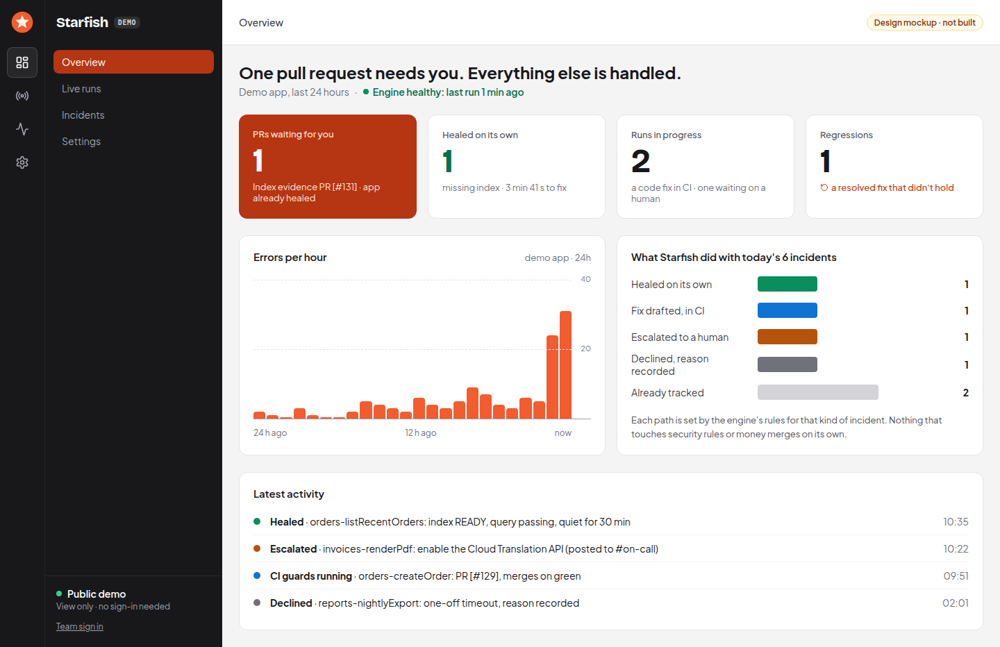

### Live runs, one per MVP case

Missing index: Starfish creates the index; the evidence PR waits for a human.

Code fix: Gemini's patch, verify gate, CI guards, merge on green, CI deploys, fast-revert armed.

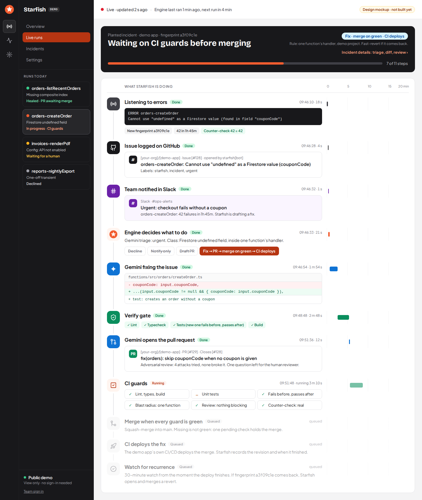

Notify-only: a patch can't fix it. Escalated in Slack; with no reply, Starfish phones the on-call person.

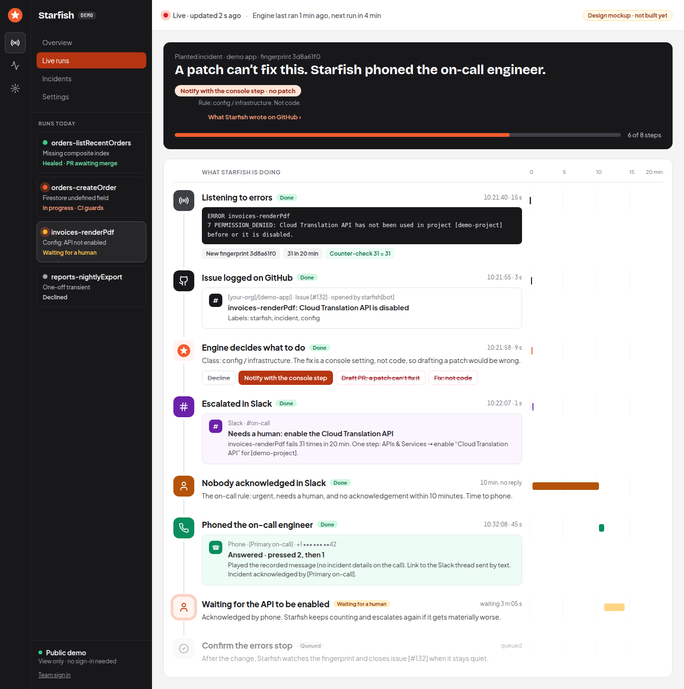

Decline: a one-off transient, with the reason recorded.

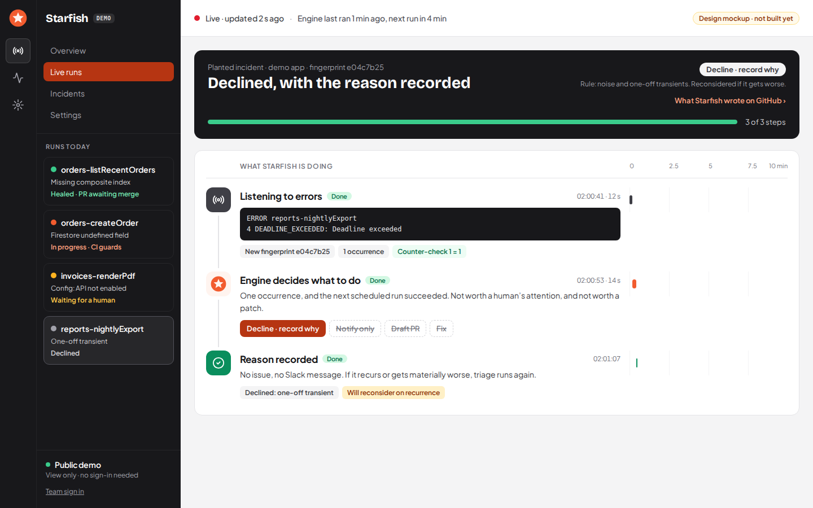

### Incident story and the incidents table

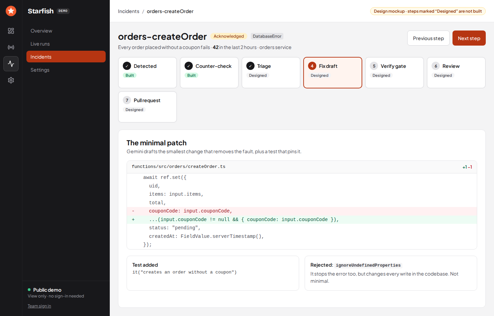

The incidents table exists today. In this mockup it carries demo data, and its menu shows the planned Overview, Live runs and Settings pages.

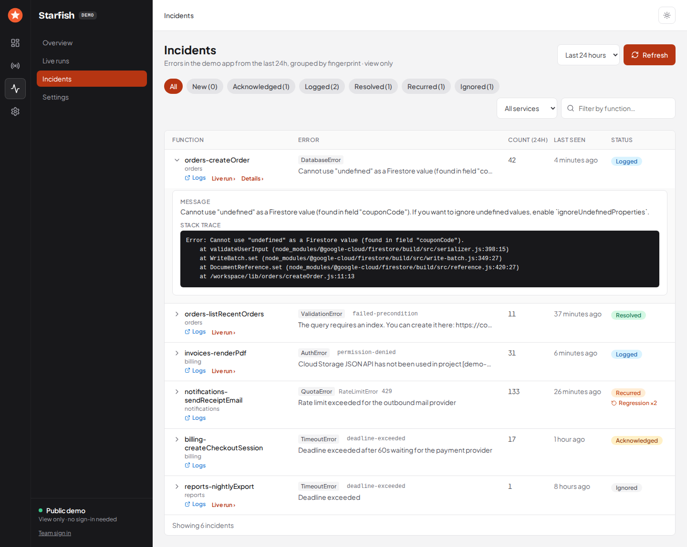

### What Starfish writes elsewhere

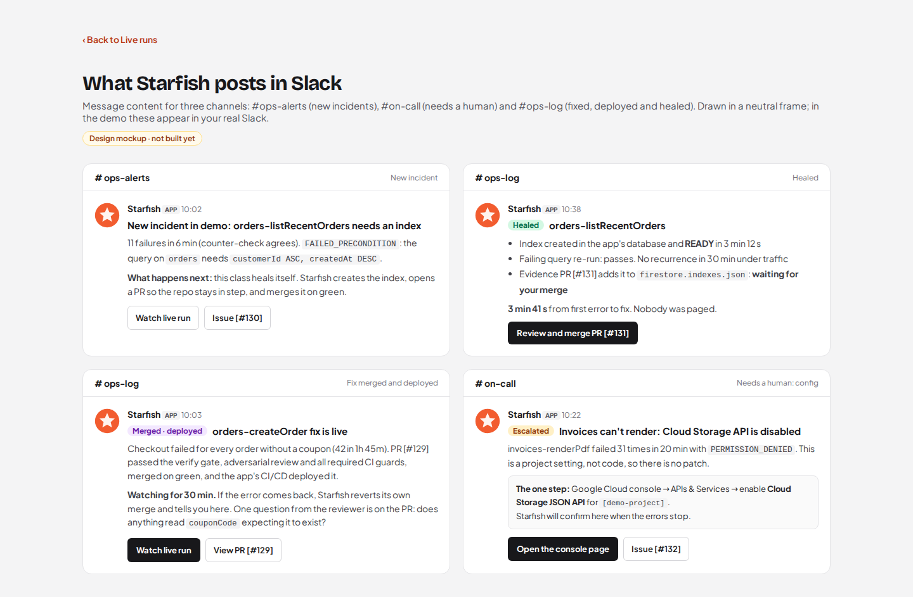

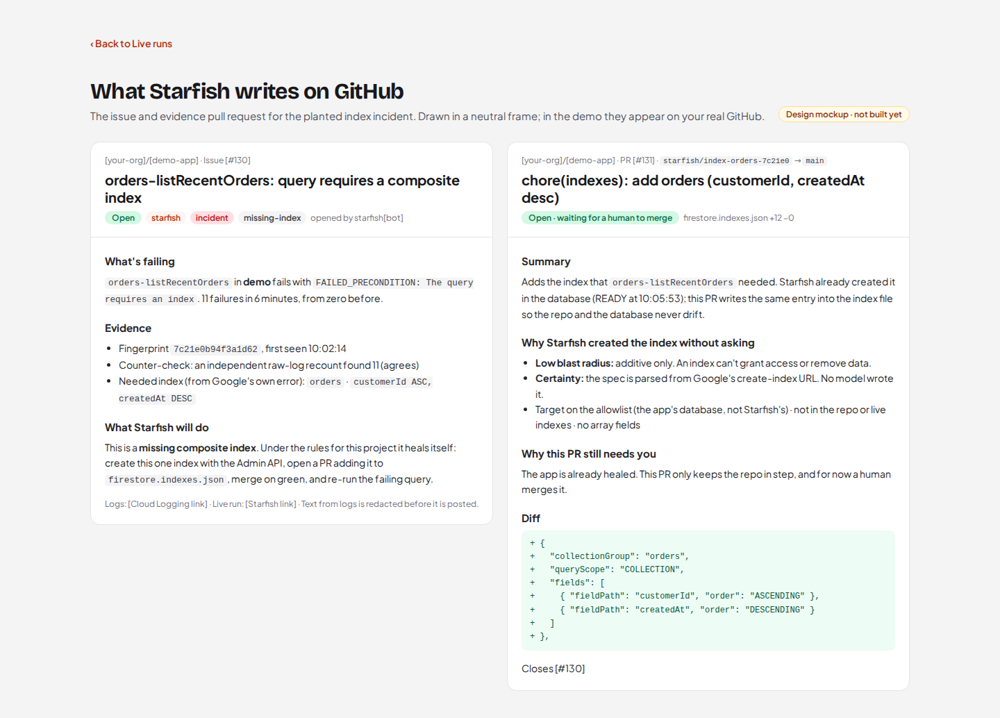

### Phone escalation

There is no AI on the call. Google Cloud has no outbound phone line of its own, so a
telephony provider (Twilio in the design) places the call, and a Cloud Run service plays one
pre-recorded message and reads the keypad: 1 take it, 2 text me the link, 3 pass it on. The
message says nothing about the incident, so nothing can leak by voice and nothing in a log
can steer it. Tracked in #37; it needs a paid telephony account, so it waits on a go-ahead.

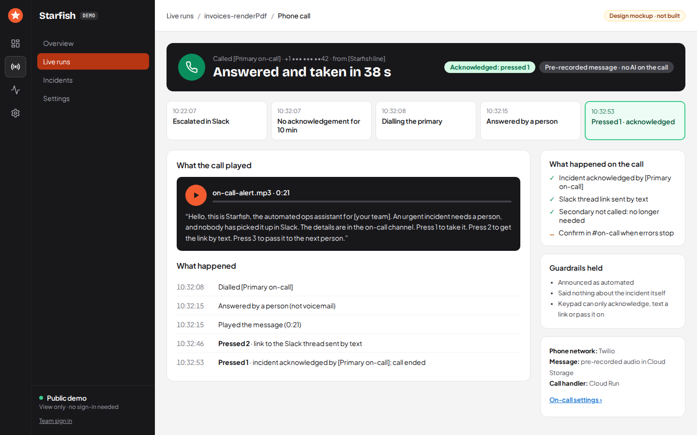

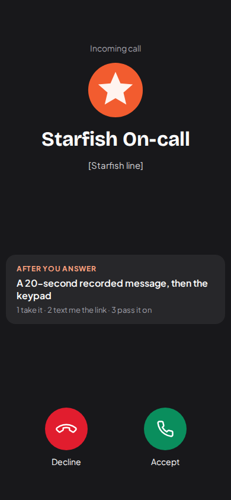

### Settings

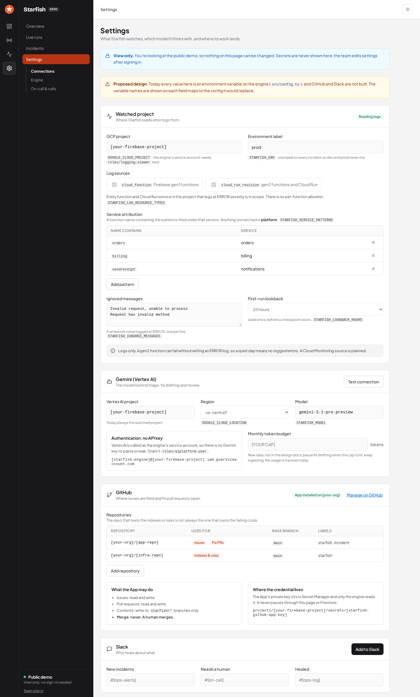

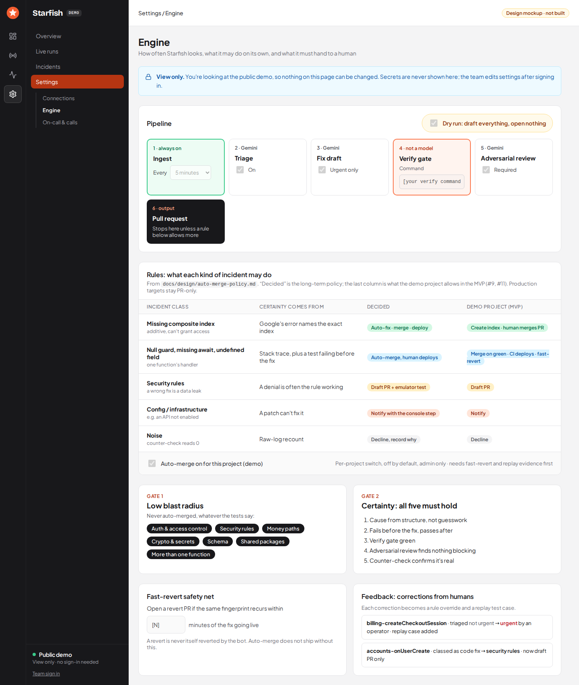

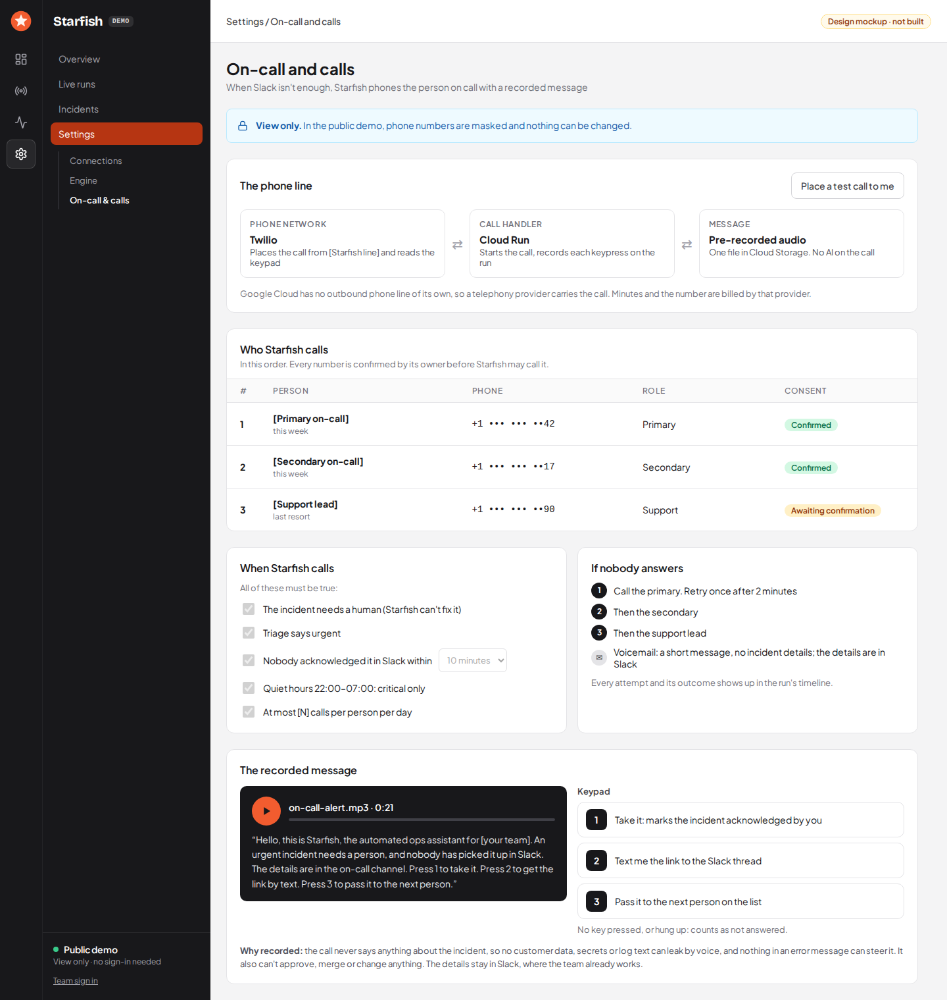

### How it works

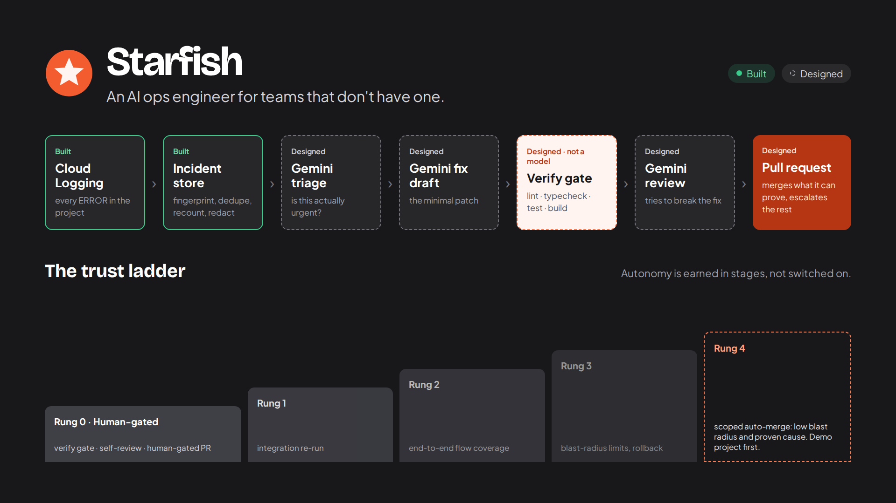
