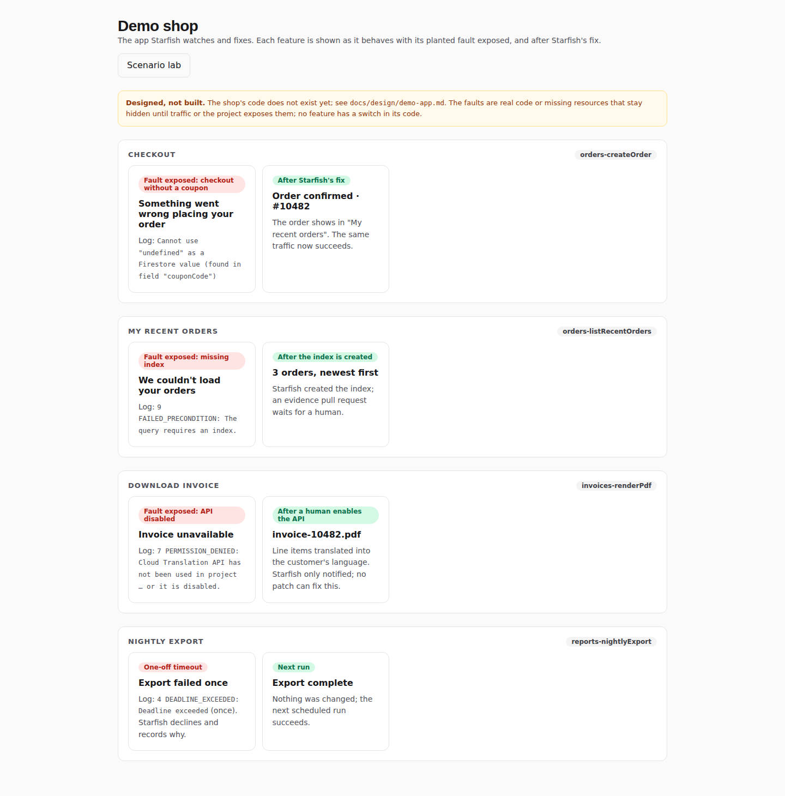
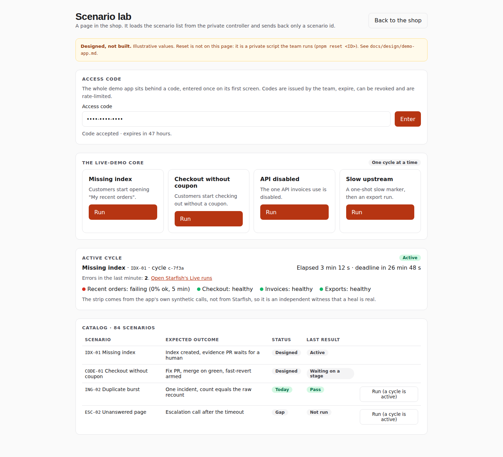

# UI mockups

> **Status: design mockups, partly built.** These are the designs of the operator UI and the demo, drawn before the
> pages were built. The data on every screen is illustrative, not real, and no screen here is a capture of the product:
> for that, see the captures of the public demo in [`../ui.md`](../ui.md) (`docs/screenshots/`). Where a page is now built, it differs
> from its mockup; the table below says which screens have a built page and how they differ.

| Mockup | Built page | How the built page differs |
|---|---|---|
| **Overview** | `web/src/pages/Overview.tsx`, the landing page | Counts and medians of stored records only, never an accuracy score, with the engine's and the agent's status lines; "healed on its own" counts only index runs the engine recorded healed, and none has been. |
| **Live runs** | `web/src/pages/Runs.tsx` (the Runs page) | A run list beside a dark hero card for the chosen run, a horizontal track of steps and a text step log under it, each step marked with who did it. No per-step time axis or rich per-step cards (log excerpt, issue card, Slack preview) as drawn. The deploy and recovery steps are not built, and no missing-index run has gone through the real system. |
| **Incident story** | `web/src/pages/IncidentDetail.tsx` (`/incidents/:id`, the evidence page) | One page of stored records (detected, recount, triage, fix, verify, review, PR), not a step-by-step story; it keeps the patch's SHA-256, not its text, and links to the PR's diff. |
| **Incidents** | `web/src/pages/Incidents.tsx` | Under each error, the agent's run for its current recurrence and its issue or PR. |
| **Settings** (connections, engine rules, on-call) | `web/src/pages/Settings.tsx`, `SettingsEditor.tsx`, `OnCallEditor.tsx` | Connections read the agent's own report ("configured", never "connected"); the rules and feedback engines' card and the runtime settings editor; On-call for admins only. |
| **Slack and GitHub** | The messages and the issue and PR bodies the agent writes (`src/integrations/`) | Fixed templates over redacted fields. Both Slack messages posted for real since 2026-10-11, issues and PRs opened on real GitHub since 2026-10-12; the merge, evidence comment and revert never run against real GitHub. `#ops-log` ("Healed") is not built. |
| **Phone escalation** | `src/oncall/` | Built, off by default, never run against real Twilio. |
| **The demo app** (shop and Scenario lab) | The separate demo-app and demo-control repositories | Not part of this repository. |
| **How it works** | None | A slide for the pitch, not a page. |

The mockups follow the decisions already tracked in the issues:

- **Code fixes** auto-merge on green only on the demo project; its CI/CD deploys them, with fast-revert armed (#9).
- **Missing indexes:** Starfish creates the index; the evidence PR is human-merged (#11).
- **The four MVP demo cases** are a code fix, a missing index, notify-only and decline (#5).
- **The public demo needs no sign-in:** visitors are view-only guests (#12).
- **The demo app shares Starfish's GCP project** (#32).
- **The screens are tracked as issues:** Live runs (#33), Overview (#38), incident detail (#39), phone escalation (#37), and Settings as part of runtime configuration (#7).

Every screen is also saved as a static HTML page in [`html/`](html/), 31 pages including each
Live runs case and each incident-story step. Open [`html/index.html`](html/index.html) in a browser
after cloning; the links between screens work. GitHub shows HTML files as source, not as pages. The pages
need nothing but a browser: no build and no runtime. Their only external request is Google Fonts, and
without it they fall back to system fonts.

The screenshots below are rendered at 1× from the same designs.

## The demo flow

| Screen | What it shows |
|---|---|
| **Overview** | One PR waiting for a human, runs in progress, errors per hour, what Starfish did with today's incidents, engine health. |
| **Live runs** | A real-time waterfall of one fault cycle: each step's status, timestamp, duration and bar on the run's time axis. One run per MVP case. |
| **Incident story** | One incident step by step: detected, counter-check, triage, fix diff, verify gate, adversarial review, PR. |
| **Slack and GitHub** | The messages Starfish posts (`#ops-alerts`, `#on-call`, `#ops-log`) and the issue and evidence-PR bodies it writes. |
| **Phone escalation** | When Slack goes unanswered: a pre-recorded call to the on-call person with keypad options. |
| **The demo app** | The shop with each feature's broken and working states, and the Scenario lab (a thin client page inside the shop): access code, the four core buttons, the active cycle with its deadline, the health strip and the catalog. |
| **Settings** | Connections, the engine's rules table, and on-call. View-only for the public. |

### The demo app

The shop with each feature's broken and working states, then the Scenario lab.

> The notify case now disables the Cloud Translation API, not Cloud Storage (disabling Cloud Storage would break deploys; decided in [#68](https://github.com/Hack2Skill-Demo/starfish/issues/68)), and the Engine screen lists dependencies and CI config among the never-auto-merged classes. The screenshots below were re-rendered from the HTML pages after those edits (2026-10-06).

### Live runs, one per MVP case

The built Runs page looks different (table above); these are the designs it started from.

Missing index: Starfish creates the index; the evidence PR waits for a human.

Code fix: Gemini's patch, verify gate, CI guards, merge on green, CI deploys, fast-revert armed.

Notify-only: a patch can't fix it. Escalated in Slack; with no reply, Starfish phones the on-call person.

Decline: a one-off transient, with the reason recorded.

### Incident story and the incidents table

In this mockup the incidents table carries demo data, and its menu shows the Overview, Live runs and Settings pages as they were planned; all of them are now built, and differ from these designs (table above).

### What Starfish writes elsewhere

### Phone escalation

There is no AI on the call. Google Cloud has no outbound phone line of its own, so a
telephony provider (Twilio in the design) places the call, and a Cloud Run service plays one
pre-recorded message and reads the keypad: 1 take it, 2 text me the link, 3 pass it on. The
message says nothing about the incident, so nothing can leak by voice and nothing in a log
can steer it. Tracked in #37; it needs a paid telephony account, so it waits on a go-ahead.

### Settings

### How it works

Each stage and rung says what is built and what has run: every stage up to the pull request has run on the demo
project (the pull request on real GitHub); auto-merge and fast-revert are built for the demo target and have never
run against real GitHub; rungs 1 to 3 are planned. Re-rendered from the HTML page on 2026-10-14 (#350).

