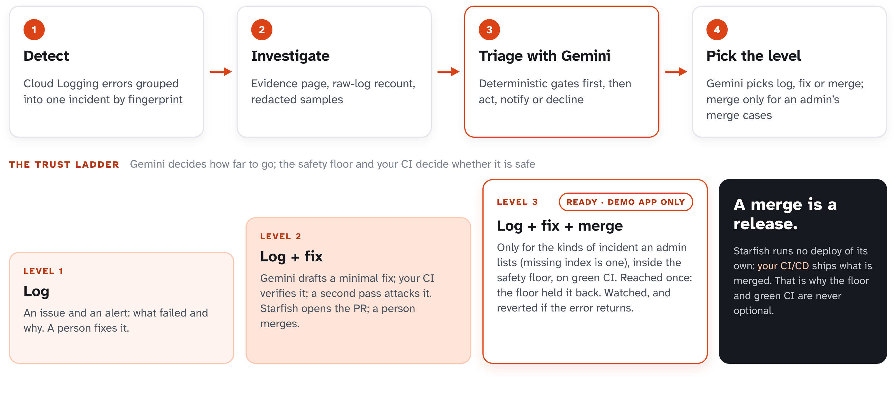

# The trust ladder

> Moved from the README (#391); the README keeps a four-line summary. What has actually run at each rung is in [status.md](status.md).

Writing a fix is the easy part. Knowing when it's allowed to act is the hard part.

Starfish runs no deploy of its own, but **a merge is a release**: the target's own CI/CD ships what
is merged. **How far it goes with an incident is Gemini's decision**, inside limits an admin sets
(decided in
[`docs/design/auto-merge-policy.md`](design/auto-merge-policy.md)):

| Level | What Starfish does | Who decides |
|-------|--------------------|-------------|
| noise | records it, files nothing | Gemini's triage: *decline* |
| **log** | a GitHub issue and an alert; a person fixes it | Gemini's triage: *notify* (also where a fix is declined or fails a check) |
| **log + fix** | the issue and a verified, reviewed pull request; a person merges | Gemini's triage: *act* |
| **log + fix + merge** | Starfish merges the fix itself, then watches for the error coming back and reverts | Gemini's triage: *act* **and** one of the admin's **merge cases** |

Merge cases are an admin's list on the Settings page (`id: description`, also `STARFISH_MERGE_CASES`),
empty by default: nothing merges until an admin lists a kind of incident that is high-value and
low-risk to fix. Gemini reads the descriptions and must name one; a case it names that is not listed
is dropped. `missing-index` is the index path's own case: no model, since Google's error names the
index; listed, its evidence pull request merges once the checks are green. **The model decides
whether to merge; it never decides what is safe to merge.** Every merge also needs, checked again
right before it: the switches (`STARFISH_AUTO_MERGE_TARGETS` lists the target, the demo; an admin
turned `autoMerge` on; dry run and the merge freeze off; the case still listed), the **safety floor**
(one production file; tests only as new files, so a fix can't turn CI green by weakening a test; nothing
on the hard-exclude list's words: auth and access control, security rules, money, secrets, schema,
dependencies and imports, CI config, shared packages, judged on the whole function around each change;
and, since a list of words misses a check that names none of them, rules on the code itself: at most 40
changed lines; no line that decides or calls anything removed or altered (beyond adding `?.`, `?? null`
or `await`); no `try`/`catch` and no `if`/`return`/`throw`/loop added except an explicit null guard; no
existing code wrapped in a new block or function; no network, process, dynamic-code, destructive or
file-system call and no `://` added; no call the file did not already make but a few pure ones such as
`String` or `Array.isArray`; no JSX file. Not judged: a `?:`, `&&` or `||` added inside an expression, or
which object a reused method is called on; a scanner, not a proof),
**every required check green on the exact head**, at most `STARFISH_MAX_MERGES_PER_DAY` (3) a day, and
an evidence comment posted first. Fast-revert is built with it: the same incident seen again within N
minutes of a code merge opens and merges a revert. **Built for the demo target behind default-off
switches, tested against fakes and the emulator, never run against real GitHub.** Rungs 1 to 3 are
still not built, which is why every other target stays PR-only.

People can always hold Starfish back, never push it further (`src/triageRules.ts`, #267):

- **Rules engine.** An admin's class rules (Settings → Class rules, also `STARFISH_CLASS_RULES`) match an
  incident's error type, error code, service or function and set the most Starfish may do with it: *noise*
  declines it without asking the model, *log* turns Gemini's *act* into an issue for a person, *fix* opens
  the pull request but never merges it.
- **Feedback engine.** An operator corrects one incident from its page: "this should have gone no further
  than X". The correction caps that incident the same way. It stops a merge still waiting for its checks.
  A declined incident corrected to anything above noise goes back to triage. Every correction is kept as
  history, and `pnpm feedback-corpus` turns the noise and log corrections into replay cases, so
  `pnpm replay` can measure whether Gemini's own triage now agrees.

The lowest cap wins, so an operator can't lift an admin's rule. Widening what merges stays the admin's
merge cases and switches: Starfish never widens a class by itself, from a replay score or anything else.
**Built, tested against fakes and the emulator; not yet run on a real incident.**
Autonomy is earned in stages, not switched on:

| Rung | Guardrail | Status |
|------|-----------|--------|
| 0 | Full verify gate on every patch | built; ran on the demo project (the target's own CI judged the patch behind demo-app #41, 2026-10-12) |
| 0 | Adversarial self-review before a human sees it | built; ran on the demo project (it reviewed that same patch) |
| 0 | Human-gated stop at PR — runs no deploy; merges nothing (and so releases nothing) unless rung 4 is switched on for that target | built; ran on the demo project (demo-app #41, #42 and #49 stopped at the pull request; Starfish merged none, a person merged two) |
| 1 | Integration-suite re-run required for merge eligibility | planned |
| 2 | End-to-end coverage of the affected user flow | planned |
| 3 | Blast-radius limits + rollback/canary story | planned |
| 4 | Scoped auto-merge: Gemini names an admin's merge case, inside the safety floor, on green checks, with fast-revert | built for the demo target only, off by default, never run against real GitHub; every other target waits on 1–3 |

Each rung is a prerequisite for the next. Rung 4 is not a switch we get to flip on our own.
