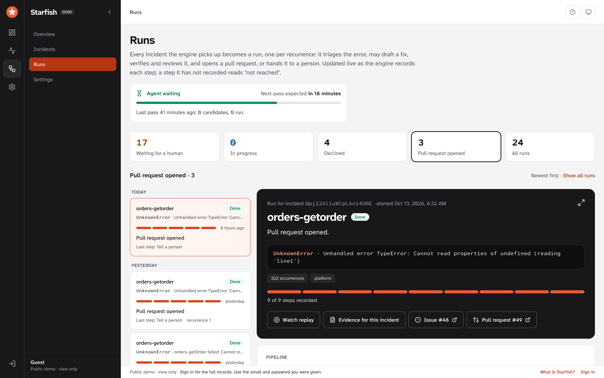
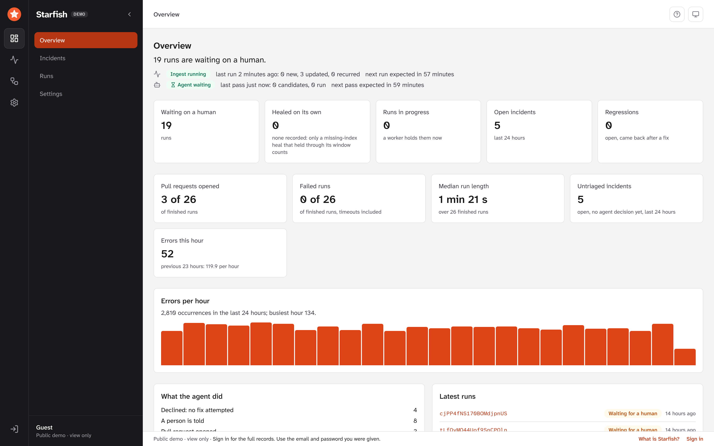
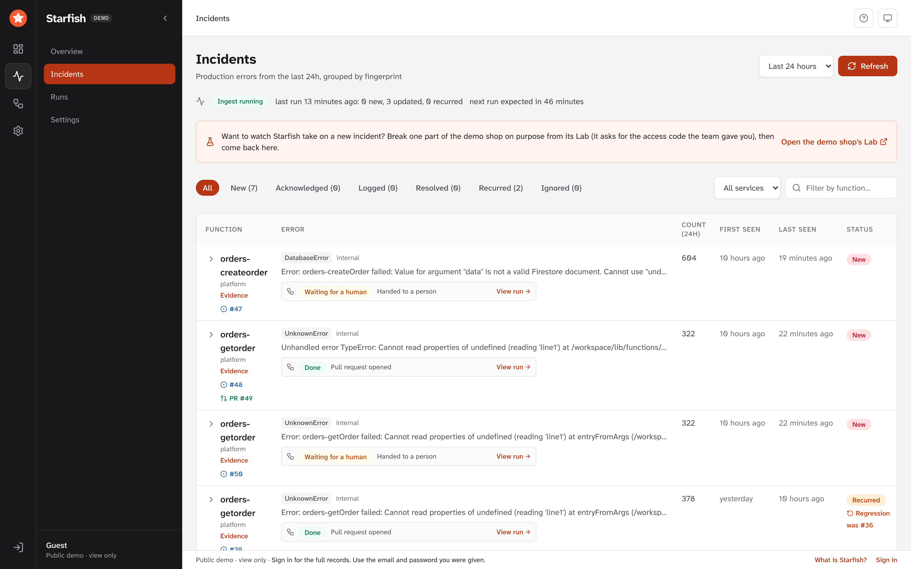

# Where the UI is heading, and what it looks like

> Moved from the README (#391). What the UI shows is only ever stored records; what has run behind it is in [status.md](status.md).

**Partly built.** The operator UI today has sign-in, an **Overview** landing page, the
incidents table, an editable settings page, a **Runs** page and an incident evidence page. The mockups below show where it is going and how the
demo runs.

- **Live runs:** a first version is built: the **Runs** page lists the agent's cycles and draws
  each one's steps (triage, fix, verify, review, pull request) from the events the engine records,
  live. A step with no event reads "not reached", and a run with no worker holding it is not shown
  as in progress. **The agent job that fills it runs on the demo project, hourly** (deployed 2026-10-07 in dry run; live since 2026-10-10; its first
  runs, on 2026-10-08, stopped at the fix stage, #259, and on 2026-10-12 one run reached a pull request, with nothing merged by Starfish); on a deployment without it the page is empty unless the synthetic demo history (`pnpm seed-demo`, badged "Synthetic") was written; it is exercised against the emulator with seeded data. The header shows the path, the
  triage rule, progress (steps recorded) and the engine's last run. The GitHub-issue and Slack steps appear when a run
  recorded them. A missing-index run shows its own steps (the index, then its evidence pull request) and where the
  index stands at runtime (watching, healed, recurred). The phone escalation's calls (#37) appear as one step when a
  run recorded them. Not built: the deploy and recovery steps (the loop has no code for them), and the four MVP cases
  observed end to end (#33 stays open).
- **Incident evidence:** a first version is built: `/incidents/:id`, linked from the incidents table
  and from the Runs page, shows what was detected and, from the agent's run record, the triage,
  fix, verify, review and pull request results, with "not reached" for any stage not recorded. It
  draws the incident's last 24 hours of occurrences as bars, and shows the independent raw-log recount triage
  judged on (beside the store's count, with the exact filter when it is short enough to keep whole; a missing
  recount says missing, never zero), the model that decided, the alternatives the fixer rejected and each
  attack the reviewer tried. It does not store the patch text (only its SHA-256): when a pull request was opened,
  the fix stage links to its diff on GitHub instead.
- **Overview:** a first version is built and is the page the app opens on: how many runs wait on a
  human, runs in progress, open incidents, regressions, errors per hour (from the incidents' hourly
  buckets), key figures (pull requests opened and failed runs, each as "n of N finished runs"; median run length; untriaged open incidents; errors this hour against the hours before it), what the agent did by path (each row opens the Runs list filtered to runs that ended that way), the latest runs, the latest activity (the newest run events across all runs, each opening its run) and the engine's status. Every figure is a
  count or median of stored records, not an accuracy score (no run has been scored; see `scoreboard/FORMAT.md`). "Healed on its own" counts
  only missing-index runs the engine recorded as healed after their quiet window (`src/indexheal/observe.ts`) and opens the Runs list filtered
  to them; a merged pull request is never counted as healed (the auto-merge step records a merge on the cycle, `summary.merge`, but the
  Overview does not count it), and nothing has been healed or merged on a real project. On a real deployment the run
  counts are zero until a job runs the agent loop.
- **Slack messages and GitHub issue/PR bodies:** what Starfish posts elsewhere.
- **Pre-recorded phone call:** to the on-call person when Slack goes unanswered. Built (#37, below), off by default,
  never run against real Twilio.
- **Settings:** connections, the engine's rules and on-call.

The Incidents page opens with a line saying whether the engine is running (from the engine's last-run record: failed, stopped past a configurable threshold, falling behind the newest logs, read capped, or never recorded), so a quiet list can't pass for good news; the scheduled ingest job writes that record (`scripts/deploy-gcp.sh` deploys and schedules it; deployed once, on the demo project, 2026-10-05, #6). Under each incident's error is the agent's run for its current recurrence: the run's state (in the Runs page's words), triage's reason as recorded, and a link that opens that run on the Runs page; the expanded row has the decision, its rule and the reason in full. It says "No agent run yet" only when every run of the environment was read, and nothing when it could not tell.

The public demo needs no sign-in: a visitor is signed in anonymously and sees the Overview, the incidents and their evidence, the Runs page and a view-only Settings page, all for the `demo` environment only, with no triage buttons (#12). A guest never reads the stored incident, cycle or event documents: `firestore.rules` serve a guest only **trimmed copies** the engine writes for the `demo` environment (#18, see [Redaction limits](implementation-notes.md#redaction-limits) below), so the guest pages show no error detail, stack trace or model reasoning. That needs Anonymous sign-in enabled in the Firebase project and only `demo`-labelled data. App Check is built as an option, off unless the UI is built with a reCAPTCHA site key (`VITE_STARFISH_APPCHECK_SITE_KEY`), and enforcing it on Firestore is a console step left to a person; an optional uptime check and alert on the site come with `UPTIME_CHECK=1 scripts/deploy-web.sh`. Both are tested only with stubs and dry runs, never on a real project ([deploy.md](deploy.md#app-check-and-the-uptime-check-12)). Until the agent has carried real incidents through every stage, the demo can also carry a **synthetic** evidence history: `pnpm seed-demo` (see [Synthetic demo history](development.md#synthetic-demo-history)), every record of which the UI badges "Synthetic". A private deployment leaves Anonymous sign-in disabled and still requires an operator account.

**Open actions for visitors (built, off by default, never run on the real project).** A demo deployment can let a visitor with no account do what an operator does (acknowledge, resolve, ignore, reopen, "Retry with agent", "Correct triage") and start "Run ingest now" and "Run agent now", and read the demo's full records instead of the trimmed copies: `PUBLIC_DEMO_ACTIONS=true` for `scripts/deploy-gcp.sh` (the admin API's `STARFISH_PUBLIC_DEMO_ACTIONS`, demo environment only) and a web build with `VITE_STARFISH_PUBLIC_DEMO_ACTIONS=true`. Every visitor action goes through the admin API with the Admin SDK and is audited (`src/publicDemo.ts`); `firestore.rules` gain no anonymous write, and serve a guest the full records only while an engine-written gate document says so. To protect the cloud and model billing, the actions are limited per IP address in a Firestore counter shared by every instance (`src/publicDemoLimit.ts`; by default 30 incident actions and 3 ingest or agent starts an hour from one address, and 6 visitor-started agent passes an hour in all), and the guest bar and welcome guide say so only when the flag is on. Settings, On-call and Retire stay admin-only. The risks (anyone can spend Gemini calls and have the agent file issues and pull requests and post to Slack, within the limits and the agent's own caps) and how to turn it on: [deploy.md](deploy.md#the-public-demos-open-actions-visitors-act-within-per-address-limits). Tested with stubs and the Firestore emulator only.

**What it looks like.** These are captures of the public demo's guest view, taken on 2026-10-14 (the guest view shows trimmed
copies of the records, so error detail and the model's own words are left out):

*Runs: a run that went from triage to a pull request on the demo app (issue #48, PR #49). The merge was not made: the safety floor
refused it and a person was told.*

*Overview: the engine and agent status, and counts of stored records only.*

*Incidents: errors grouped by fingerprint; under each, the agent's run and its issue or pull request.*

Design mockups of every screen, including ones not built yet, and what each is for: [`docs/design/mockups.md`](design/mockups.md).
To click through them, open [`docs/design/html/index.html`](design/html/index.html) in a browser after cloning
(GitHub shows HTML files as source, not as pages).
